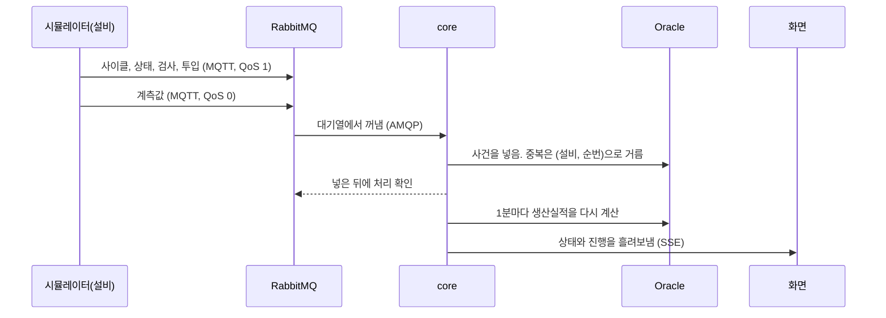

# 아키텍처

## 데이터가 흐르는 길

## 지키는 규칙

- **에이전트는 DB에 직접 닿지 않습니다.** core의 MCP 도구만 부릅니다. 권한 검사는 MCP 서버에서 합니다.
- **변경은 세 단계입니다.** 변경안 등록, 사람의 승인, 실행. 승인 기록이 없으면 MCP 서버가 실행을 거부합니다.
- **사건과 계측값을 다르게 다룹니다.** 사건(사이클, 상태, 검사, 투입)은 하나도 잃지 않도록 디스크에 저장되는 대기열과 처리 확인을 씁니다. 계측값은 늦으면 버리고, DB에는 1분 요약만 넣습니다.
- **수집기는 멱등입니다.** 같은 메시지가 두 번 오거나 순서가 바뀌어도 집계가 같습니다.
- **화면은 core가 보낸 것만 그립니다.** 시뮬레이터에서 직접 받지 않습니다.
- **브로커는 밖에 열지 않습니다.**

## 구성 요소

| 구성 요소 | 하는 일 | 기술 |
| --- | --- | --- |
| core | 업무 API, 수집기, 배치, MCP 서버, SSE, DB 스키마 | Kotlin, Spring Boot, MyBatis, Flyway |
| 시뮬레이터 | 설비 20대의 흉내. 과거 데이터 생성과 실시간 발행 | Python |
| 운영 에이전트 | 질문에 답하고 변경안을 올림 | Python, FastAPI, LangGraph |
| 화면 | 픽셀 공장 화면, 현황판, 승인 화면 | React, Canvas |
| DB | 업무 데이터와 문서 검색 | Oracle (VECTOR 타입 포함) |
| 브로커 | 설비 메시지의 중계 | RabbitMQ (MQTT 플러그인) |
