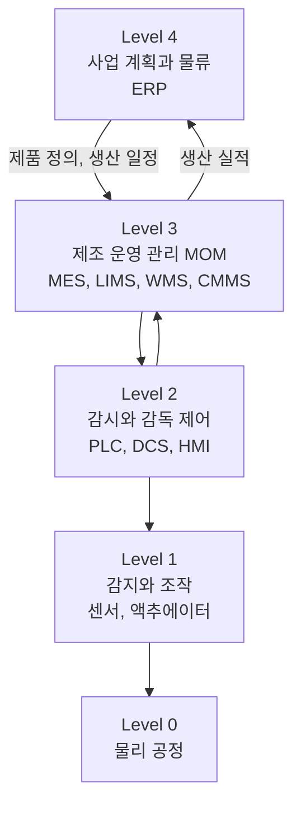

# ERP, MES, SAP란 무엇인가

이 페이지는 제조 IT를 처음 접하는 개발자가 ERP, MES, SAP를 자기 말로 설명할 수 있도록 정리한 도메인 지식 문서입니다. 2026-11-25에 조사한 내용을 바탕으로 했고, 제품 이름과 유지보수 일정은 그 날짜 기준입니다. 이 프로젝트의 배경은 [배경](#/background)에, 낱말의 뜻은 [용어집](#/glossary)에, 공장에서 일이 일어나는 순서는 [공장 흐름](#/factory-flow)에 있습니다.

| 이름 | 한 문장으로 |
| --- | --- |
| ERP | 회사의 돈, 물건, 주문에 관한 거래를 한 데이터베이스에 기록해 부서마다 같은 숫자를 보게 하는 업무 시스템입니다 |
| MES | 오더가 현장에 내려온 때부터 완제품이 나올 때까지, 현장에서 일어나는 일을 그 시각에 안내하고 기록하는 시스템입니다 |
| SAP | ERP를 만드는 독일 회사의 이름입니다. 이 회사의 ERP 제품은 R/2, R/3, ECC를 거쳐 지금은 S/4HANA입니다 |

표의 세 문장은 아래 본문의 출처를 이 문서가 줄인 것입니다. 본문의 문장과 표에는 출처를 각주로 달았습니다. 원문을 열지 못하고 검색 결과의 요약만 본 것, 2차 자료에만 기댄 것, 조사 노트가 추론이라고 적은 것은 그 문장 안에 그렇게 적었습니다.

## ERP

### 정의

ERP(Enterprise Resource Planning)는 재무, 인사, 제조, 공급망, 영업, 구매 같은 핵심 업무를 하나로 묶어 보여 주는 소프트웨어 시스템입니다[^erp-def]. SAP는 ERP가 "single source of truth"를 준다고 설명합니다. Oracle은 ERP가 하나의 정의된 데이터 구조를 중심으로 설계되고 보통 공통 데이터베이스를 가진다고 설명합니다[^erp-def].

두 회사의 설명에서 공통인 것은 구조입니다. 모듈은 업무 영역별로 나뉘지만 같은 데이터베이스를 씁니다[^erp-def].

### 계보: MRP에서 클라우드 ERP까지

ERP는 자재 계산 프로그램에서 출발해 범위를 넓혀 온 것입니다. 아래 표는 각 단계가 앞 단계의 어떤 빈자리를 메웠는지를 정리한 것입니다[^erp-lineage].

| 단계 | 시기 | 푼 문제 |
| --- | --- | --- |
| 재주문점 | 1913년의 EOQ 모형 | 품목마다 "얼마 남으면 얼마를 주문"을 따로 정했습니다. 완제품 계획과 부품 주문은 이어져 있지 않았습니다 |
| MRP (Material Requirements Planning) | 1964년, 1970년대에 제조업의 표준 | 완제품의 납기와 BOM에서 거꾸로 계산해 부품이 언제 얼마나 필요한지를 구합니다 |
| MRP II (Manufacturing Resource Planning) | 1983년 | MRP는 자재만 봤습니다. MRP II는 설비와 인력의 능력 계획, 현장 통제, 재무를 더했습니다 |
| ERP | 1990년 무렵 | 제조 밖의 재무, 인사, 영업까지 같은 시스템과 같은 데이터로 묶었습니다 |
| 클라이언트-서버 ERP | 1990년대 | 메인프레임에서 클라이언트-서버로 옮겨 더 많은 사용자가 더 싸게 쓰게 됐습니다 |
| 클라우드 ERP | 1990년대 말에 등장 | 서버 운영과 업그레이드를 벤더가 맡고 구독으로 씁니다 |

이 연표에는 단서가 세 가지 붙습니다.

- ERP라는 이름은 1990년에 Gartner가 붙였다고 널리 전해집니다. 이번 조사에서 Gartner의 원문은 열지 못했고, 기술 매체와 벤더의 글로만 확인했습니다[^erp-gartner].
- MRP의 1964년(IBM의 Joseph Orlicky, 첫 도입 사례 Black & Decker)과 MRP II의 1983년(Oliver Wight)은 벤더 글과 기술 매체에 기댄 연도입니다. Wikipedia는 1950년대 Rolls-Royce와 GE의 전산화를 MRP의 시작으로 먼저 듭니다[^erp-gartner].
- MRP는 사라지지 않고 ERP 안의 한 모듈로 남았습니다. 거의 쓰이지 않게 된 말은 MRP II입니다[^erp-lineage].

### "하나의 통합 데이터베이스"의 뜻

영업, 구매, 생산, 재고, 회계가 같은 마스터 데이터와 같은 거래 데이터를 본다는 뜻입니다. SAP의 문서는 재고 관리가 모든 거래에서 다른 물류 구성요소와 함께 쓰는 마스터 데이터와 거래 데이터에 접근한다고 적습니다[^erp-integration].

SAP의 예 두 가지가 이 뜻을 잘 보여 줍니다.

- 창고에서 자재 이동을 전기(posting, 장부에 확정해 적는 일)하면 자재 문서가 생깁니다. 그 이동이 회계에 영향을 주면 회계 문서가 자재 문서와 나란히 생깁니다[^sap-doc].
- 출하를 전기하면 재고의 수량과 금액이 줄고, 그 금액 변화가 재무회계에 반영되며, 그 납품이 청구 대상 목록에 올라갑니다[^o2c].

SAP는 이 원칙을 문서 원칙이라고 부릅니다. 재고를 바꾸는 모든 사건에는 문서가 있어야 하고, 전기한 문서는 고치지 못하며 취소 문서로 되돌립니다[^sap-doc]. 창고에서 한 번 입력한 것이 곧바로 회계와 계획의 입력이 되므로 부서 사이에 숫자를 맞춰 보는 일이 줄어든다는 것은 조사 노트의 해석입니다.

### 제조업 ERP의 기능 영역

SAP의 교육 자료는 ERP의 업무 영역을 아래처럼 나눕니다[^erp-lob]. SAP는 Finance, Sales, Sourcing and Procurement를 관리 쪽 ERP로 묶고, 물건을 만드는 회사는 그 위에 운영 쪽 영역을 더한다고 설명합니다.

| 영역 | 하는 일 |
| --- | --- |
| Finance | 예산, 매입 채권과 매출 채권, 기간 마감, 재무제표 |
| Sales | 고객 주문의 접수와 확인, 납품, 반품 |
| Sourcing and Procurement | 필요한 것을 정하고, 공급사에 발주하고, 물건을 받고, 대금을 치릅니다 |
| R&D Engineering | 제품 설계. 결과물인 BOM이 Manufacturing으로 넘어갑니다 |
| Manufacturing | MRP로 무엇이 사내에 있고 무엇을 사야 하는지 정하고, 생산 일정을 잡고 실행합니다 |
| Asset Management | 생산에 쓰는 설비의 보전 |
| Supply Chain | 창고 관리, 출하 납품, 운송 |

### 마스터 데이터와 거래 데이터

마스터 데이터는 오래 유효한 데이터이고, 거래 데이터는 유효한 시점이 있는 데이터입니다. 이 구분은 SAP 도움말의 검색 결과 요약으로만 확인했습니다[^master-tx]. 풀어 쓰면 마스터 데이터는 "무엇으로, 어디서, 어떻게 만드는가"이고 거래 데이터는 "언제 얼마나 주문받고, 만들고, 옮겼는가"입니다. 이 풀이는 조사 노트의 해석입니다.

제조에서 중요한 마스터 데이터는 네 가지입니다[^sap-master].

| 마스터 데이터 | SAP 문서의 정의 | 사출성형 공장의 예 |
| --- | --- | --- |
| Material master (자재 마스터) | 회사가 한 자재를 관리하는 데 필요한 모든 정보를 담은 레코드 | 사이드 몰딩 완제품, 성형품, 수지 |
| BOM (자재명세서) | 제품을 이루는 구성품의 정형화된 목록. 구성품마다 수량과 단위를 가집니다 | 완제품 1개는 성형품 1개와 클립 2개 |
| Routing (라우팅) | 공정의 순서. 생산오더의 틀이 되고 원가 계산의 기준이 됩니다 | 사출 다음에 조립 |
| Work center (작업장) | 공정이 실행되는 곳. 기계, 기계 그룹, 생산 라인, 작업자 그룹을 나타냅니다 | 650톤 사출성형기 3호기 |

표의 오른쪽 칸은 이 문서가 붙인 예입니다. SAP의 문서는 work center를 BOM, routing과 함께 생산 계획에서 가장 중요한 마스터 데이터라고 적습니다[^sap-master].

### 문서 흐름

ERP의 거래는 문서가 다음 문서를 낳는 흐름으로 이어집니다. 판매 쪽 흐름은 주문에서 청구까지이고, 구매 쪽 흐름은 구매요청에서 지급까지입니다. 생산은 그 사이에 끼어 있습니다[^o2c] [^p2p].

판매와 생산 쪽입니다. 주문이 계획과 생산을 거쳐 출하와 청구로 이어집니다.

구매 쪽입니다. MRP가 사 와야 할 것을 구매요청으로 만들고, 그것이 입고와 지급으로 이어집니다.

| 쪽 | 문서 또는 단계 | 영어 | 하는 일 |
| --- | --- | --- | --- |
| 판매 | 판매오더 | Sales order | 고객의 주문입니다. MRP에서는 고객 소요로 잡힙니다 |
| 생산 | 계획오더 | Planned order | MRP가 만든 제안입니다. 생산오더로 전환됩니다 |
| 생산 | 생산오더 | Production order | 어떤 자재를 어디서 언제 얼마나 만들지 정합니다. 원가 계산의 대상이기도 합니다 |
| 생산 | 자재 출고 | Goods issue | 오더에 쓰는 구성품을 창고에서 뺍니다 |
| 생산 | 실적 확인 | Confirmation | 양품, 불량, 재작업 수량과 들어간 작업량, 교대를 기록합니다 |
| 생산 | 완제품 입고 | Goods receipt | 만든 물건이 창고로 들어옵니다 |
| 판매 | 출하 납품과 출하 전기 | Outbound delivery, Post goods issue | 판매오더를 참조해 납품을 만들고, 꺼내고, 재고를 줄입니다 |
| 판매 | 청구 | Billing | 출하 전기 뒤에 납품이 청구 대상이 됩니다 |
| 구매 | 구매요청 | Purchase requisition | 정해진 때까지 정해진 수량을 조달해 달라는 요청입니다. 사람이나 MRP가 만듭니다 |
| 구매 | 구매오더 | Purchase order | 공급사에 보내는 주문입니다 |
| 구매 | 입고 | Goods receipt | 구매오더를 참조해 받은 물건을 전기합니다 |
| 구매 | 송장 검증 | Invoice verification | 구매오더, 입고 문서, 송장의 수량과 금액이 맞는지 확인합니다 |

청구가 회계에 무엇을 전기하는지의 세부는 강의 제목으로만 확인했고 본문은 읽지 못했습니다[^o2c].

### MRP의 계산

MRP는 네 가지 계산을 차례로 합니다[^mrp-terms].

- **순소요량 계산**: 총소요량에서 보유 재고와 입고 예정을 뺍니다. 남은 것이 새로 조달해야 하는 수량입니다.
- **로트 크기 결정**: 순소요량을 실제 주문 수량이나 생산 수량으로 바꿉니다. 필요한 만큼만 만드는 방식과 정해진 단위로 묶는 방식이 있습니다.
- **리드타임 오프셋**: 입고가 필요한 날에서 리드타임을 빼서 착수일이나 발주일을 구합니다.
- **BOM 전개**: 상위 품목의 계획 착수가 하위 품목의 총소요량이 됩니다. 고객 주문처럼 밖에서 오는 수요를 독립 수요라 하고, 이렇게 계산돼 나오는 부품의 수요를 종속 수요라 합니다.

SAP의 계획 실행도 같은 순서를 따릅니다. 순소요량 계산, 로트 크기를 포함한 조달 수량 계산, 일정 계산, BOM 전개와 종속 소요 결정의 순서이고 보통 플랜트 단위로 실행합니다[^mrp-sap].

아래 예의 숫자는 설명을 위해 조사 노트가 만든 것입니다. 완제품 A 1개는 성형품 B 1개와 클립 C 4개로 이루어집니다. A는 5주차에 1,000개를 납품해야 하고 재고가 200개 있습니다.

| 품목 | 총소요량 | 쓸 수 있는 재고 | 순소요량 | 로트 적용 뒤 | 착수 또는 발주 |
| --- | --- | --- | --- | --- | --- |
| A (조립 1주, 필요한 만큼) | 1,000 (5주차) | 200 | 800 | 800 | 4주차에 조립 착수 |
| B (성형 1주, 500개 단위) | 800 (4주차) | 100 | 700 | 1,000 | 3주차에 성형 착수 |
| C (구매 2주, 1,000개 단위) | 3,200 (4주차) | 1,000과 입고 예정 500 | 1,700 | 2,000 | 2주차에 발주 |

이 표에서 읽을 것은 세 가지입니다.

1. B와 C의 총소요량은 A의 고객 주문량 1,000이 아닌 A의 계획 수량 800에서 나옵니다. 시점도 A의 납기인 5주차가 아닌 A의 착수 시점인 4주차입니다.
2. B는 700개가 모자라지만 500개 단위로 만들므로 1,000개를 만듭니다. 남는 300개는 재고가 되어 다음 계산에 쓰입니다.
3. 완제품의 납기는 5주차인데 가장 먼저 움직여야 하는 것은 2주차의 클립 발주입니다.

계산의 결과로 A와 B에는 계획오더가, C에는 구매요청이 생깁니다[^mrp-sap].

MRP에는 알려진 한계가 있습니다[^mrp-limits]. 기본 MRP는 설비 능력을 무한하다고 가정하므로 실행할 수 없는 일정이 나올 수 있습니다. 리드타임을 고정값으로 보는 결정론적 계산이어서 안전 재고와 안전 리드타임을 따로 둡니다. 수율이 y이고 N개가 필요하면 N ÷ y개로 시작합니다. 작은 변화가 일정 전체를 흔드는 문제도 있어 가까운 미래의 일정을 고정하는 대책을 씁니다.

## MES

### 정의

MES(Manufacturing Execution System)는 오더가 나간 때부터 완제품이 나올 때까지 생산 활동을 최적화할 정보를 주는 시스템입니다. MESA International이 1997년에 낸 백서는 MES가 현재의 정확한 데이터로 현장의 활동을 "안내하고, 시작시키고, 대응하고, 보고한다"고 정의했습니다[^mes-def]. 같은 백서는 MES 정보의 이점을 적시성에 두고, 초나 분 단위의 대응을 가능하게 한다고 적습니다.

SAP는 MES를 원재료에서 완제품까지 제조 과정을 감시, 추적, 기록, 통제하는 소프트웨어이고 ERP와 공정 제어 시스템 사이의 기능 계층이라고 설명합니다[^sap-mes]. Gartner의 정의는 검색 결과의 요약으로만 확인했습니다. 그 요약에 따르면 Gartner는 MES가 실시간 물리 공정의 실행을 관리, 감시, 동기화한다고 정의합니다[^mes-gartner].

### 용어가 나온 곳

MES라는 말은 1990년대 초 미국 보스턴의 AMR Research가 만들었습니다. AMR은 제조 시스템을 계획, 실행, 제어의 세 층으로 나누고 가운데 층을 MES라고 불렀습니다[^mes-origin]. 정확한 연도는 자료에 따라 1990년과 1992년으로 갈리고, AMR의 원 보고서는 찾지 못했습니다.

### MESA-11: 열한 가지 기능

MESA의 1997년 백서는 MES의 범위를 열한 가지 기능으로 정했습니다[^mesa-11]. 이번 조사에서 읽은 백서는 MESA의 공식 배포본이 아닌 문서 공유 사이트의 사본입니다. MESA International은 2026년 6월 30일에 운영을 끝냈고 교육 프로그램과 콘텐츠는 ISA(International Society of Automation)가 넘겨받았습니다[^mesa-closed]. 그래서 이 문서는 MESA의 모델을 과거형으로 적습니다.

| 번호 | 기능 (백서의 이름) | 하는 일 |
| --- | --- | --- |
| 1 | Resource Allocation and Status | 설비, 공구, 작업자, 자재처럼 작업에 필요한 자원의 상태를 관리하고 배정합니다 |
| 2 | Operations/Detail Scheduling | 우선순위와 속성에 따라 작업 순서를 정합니다. 유한한 능력을 기준으로 합니다 |
| 3 | Dispatching Production Units | 작업 단위의 흐름을 관리하고, 현장 사건에 따라 순서를 실시간으로 바꿉니다 |
| 4 | Document Control | 작업 지침, 레시피, 도면 같은 문서를 관리하고 작업자나 설비로 내려보냅니다 |
| 5 | Data Collection/Acquisition | 생산 데이터와 공정값을 현장에서 수동이나 자동으로 모읍니다 |
| 6 | Labor Management | 사람의 상태, 근태, 자격을 추적합니다 |
| 7 | Quality Management | 현장에서 모은 측정값을 실시간으로 분석해 품질 문제를 찾습니다 |
| 8 | Process Management | 생산을 감시하고 자동으로 바로잡거나 작업자의 판단을 돕습니다 |
| 9 | Maintenance Management | 설비와 공구를 쓸 수 있게 유지하는 활동을 추적하고 지시합니다 |
| 10 | Product Tracking and Genealogy | 작업물의 위치와 상태, 구성 자재의 공급자와 lot과 serial number를 기록합니다 |
| 11 | Performance Analysis | 실제 운영 결과를 과거 이력, 기대 결과와 비교해 보고합니다 |

두 번째 기능의 이름은 자료마다 조금씩 다르게 옮겨집니다. 위 표는 백서에 인쇄된 이름을 따랐습니다[^mesa-11].

### MES가 날마다 하는 일

MES의 하루는 세 가지 일로 이루어집니다. 위에서 받은 오더를 현장 단위의 작업으로 내립니다. 현장에서 일어난 사건을 받아 적습니다. 그것을 실적, 품질, 설비, 이력으로 묶어 위로 올립니다. 아래 표의 "하는 일"은 MESA 백서와 한국의 스마트공장 참조모델에서 가져왔고, "남기는 데이터"에는 조사 노트의 추론이 섞여 있습니다[^mes-daily].

| 기능 | 하는 일 | 남기는 데이터 |
| --- | --- | --- |
| 작업 배분 | 오더를 설비와 교대 단위의 작업으로 내립니다 | 작업지시, 작업의 시작과 종료 기록 |
| 생산 추적 | 무엇이 얼마나 만들어졌는지 셉니다 | 작업지시와 교대별 양품 수량과 불량 수량 |
| LOT 추적 | 완제품이 어떤 자재 LOT로 어느 설비에서 만들어졌는지 잇습니다 | 자재 LOT 투입 기록 |
| 품질 | 검사 결과와 공정값을 받아 통계로 감시합니다 | 검사 결과, 측정값, 관리도 |
| 설비 상태 | 설비가 도는지 섰는지, 왜 섰는지 적습니다 | 설비 상태 변화, 비가동 구간과 사유 |
| 성과 분석 | 위 데이터를 지표로 묶습니다 | OEE, 수율, 불량률 |

한국의 참조모델은 사출성형 공장의 기초 수준 MES가 위 시스템에서 기준정보와 생산계획을 받고, 생산실적, 작업현황, 검사실적, Lot 추적정보를 보낸다고 적습니다[^mes-daily].

### OEE

OEE(Overall Equipment Effectiveness, 설비종합효율)는 설비가 계획된 시간 동안 양품을 얼마나 만들었는지를 재는 지표입니다. 세 요소를 곱합니다. 가장 널리 인용되는 설명은 OEE 교육 사이트를 운영하는 벤더 Vorne의 것입니다[^oee-formula].

| 요소 | 식 | 뜻 |
| --- | --- | --- |
| 시간가동률 (Availability) | Run Time ÷ Planned Production Time | 돌기로 한 시간 중 실제로 돈 시간 |
| 성능가동률 (Performance) | (Ideal Cycle Time × Total Count) ÷ Run Time | 돈 시간 동안 가장 빠른 속도에 얼마나 가까웠는가 |
| 양품률 (Quality) | Good Count ÷ Total Count | 만든 것 중 양품의 비율 |

OEE는 이 셋의 곱입니다. 시간가동률 90%, 성능가동률 95%, 양품률 99%이면 약 85%입니다. 세 요소로 나누는 까닭은 숫자 하나로는 손실의 성격을 알 수 없기 때문입니다[^oee-formula].

손실은 여섯 가지로 나눕니다. 아래는 Vorne의 이름입니다[^oee-losses].

| 요소 | 손실 |
| --- | --- |
| 시간가동률 | Equipment Failure (고장), Setup and Adjustments (셋업과 조정) |
| 성능가동률 | Idling and Minor Stops (짧은 정지), Reduced Speed (속도 저하) |
| 양품률 | Process Defects (공정 불량), Reduced Yield (수율 저하) |

OEE의 정의는 표준과 자료에 따라 다릅니다.

- 여섯 손실의 이름이 자료마다 다릅니다. 미국 EPA의 TPM 소개 페이지는 여섯째를 설비와 자본 투자의 손실로 적습니다[^oee-losses].
- 계획 정지를 다루는 방식이 다릅니다. Vorne은 품목 교체를 정지 시간에 넣어 시간가동률을 깎습니다. ISO 22400-2는 분모가 되는 계획 시간에서 계획된 비가동을 먼저 뺍니다[^oee-iso]. 두 정의를 견준 것은 조사 노트의 추론입니다.
- ISO 22400-2는 목차에 손실 시간 모델에 기반한 대안 계산을 부록으로 싣고 있습니다. 표준의 KPI 식이 실린 본문은 유료라 읽지 못했습니다[^oee-iso].
- 반도체 업계는 SEMI E10과 E79를 따로 씁니다. 이 내용은 검색 결과의 요약으로만 확인했습니다[^oee-semi].

OEE는 일본 JIPM의 Seiichi Nakajima가 TPM(Total Productive Maintenance)의 지표로 내놓았다고 전해집니다. 이 기원은 2차 자료로만 확인했고 Nakajima의 책은 읽지 못했습니다[^oee-origin]. "OEE 85%가 세계 수준"이라는 말도 널리 인용되지만 원출처는 확인하지 못했고, Vorne은 그 목표를 "mythical"이라고 부릅니다[^oee-formula].

사출성형에서는 한 사이클에 캐비티 수만큼 제품이 나옵니다. 그래서 이상 사이클 타임을 사이클당으로 잡으면 수량도 사이클 수로, 개당으로 잡으면 수량도 개수로 맞춰야 합니다. 이 주의점은 조사 노트의 추론이고 직접 서술한 출처는 없습니다.

## 두 시스템의 관계: ISA-95

ISA-95는 기업 시스템과 제조 현장 사이의 통합을 다루는 표준이고 국제 표준 번호는 IEC 62264입니다. 이 표준은 Purdue Reference Model에 바탕을 두고, 주로 Level 3과 Level 4 사이의 인터페이스를 다룹니다[^isa95-std]. 표준의 본문은 유료여서 이 절은 표준 기구의 소개 페이지, 공개된 미리보기, OPC Foundation의 요약에 기댔습니다.

### Level 0에서 4까지

표준은 제조 기업의 활동을 다섯 수준으로 나눕니다. 수준을 가르는 기준은 시간입니다[^isa95-levels]. 아래 표의 사출성형 예는 조사 노트의 추론이고 표준에 있는 예가 아닙니다.

| Level | 표준 쪽 설명 | 시간 틀 | 사출성형 공장의 예 (추론) |
| --- | --- | --- | --- |
| 4 | 사업 계획과 물류 | 월, 주, 일 | ERP. 수주, 생산 계획, 재고 장부, 구매, 출하 |
| 3 | 제조 운영 관리. 작업 배분, 상세 일정, 추적 | 일, 교대, 시간, 분, 초 | MES. 작업지시를 내리고, 사이클을 모아 생산실적을 집계하고, 검사 결과와 자재 LOT 투입을 기록 |
| 2 | 감시와 감독 제어. PLC, DCS | 1초 미만 | 성형 조건대로 사이클을 돌리는 사출기 컨트롤러, 설비의 조작 화면 |
| 1 | 공정을 감지하고 조작하는 것 | 출처에 숫자 없음 | 금형 온도 센서, 사출 압력 센서, 히터, 유압 밸브 |
| 0 | 물리 공정 그 자체 | 출처에 숫자 없음 | 수지가 녹아 금형에 채워지고 식어 굳는 과정 |

"실시간"이라는 말의 뜻도 수준마다 다릅니다. Level 3에서는 현장 사건 뒤 몇 초 안에 정보가 있다는 뜻입니다. Level 4에서는 매일 또는 교대가 끝난 뒤 몇 시간 안에 있다는 뜻입니다[^isa95-levels].

SCADA를 어느 수준에 두는지는 자료마다 다릅니다. 감독 제어이므로 Level 2로 그리는 자료가 많지만, ISA의 소개 페이지는 Level 3의 설명에서 MES와 함께 SCADA를 듭니다[^isa95-levels].

### Level 3의 이름은 MOM이다

표준이 Level 3에 붙인 이름은 MOM(Manufacturing Operations Management, 제조 운영 관리)입니다. MES는 표준의 용어가 아닌 제품 범주의 이름입니다. ISO 22400-2의 서문은 MOM을 "때로 MES라고도 불린다"고 적습니다[^mom].

MOM은 네 가지 운영 영역으로 나뉩니다[^mom].

| 운영 영역 | 보통 맡는 시스템 |
| --- | --- |
| 생산 운영 (production) | MES |
| 품질 운영 (quality) | LIMS |
| 재고 운영 (inventory) | WMS |
| 보전 운영 (maintenance) | CMMS 또는 자산 관리 시스템 |

네 영역은 각각 같은 여덟 활동을 가집니다. 상세 일정, 작업 배분, 실행 관리, 자원 관리, 정의 관리, 추적, 데이터 수집, 분석입니다[^mom]. 좁게 쓰면 MES는 네 영역 중 생산 운영을 맡는 시스템이고, 넓게 쓰면 MOM 전체를 가리킵니다. 시중의 MES 제품이 품질과 보전 기능 일부를 함께 담는다는 것은 MESA-11에 그 기능이 들어 있다는 사실에서 나온 조사 노트의 추론입니다.

### Level 3과 4 사이에 오가는 정보

표준의 목차는 두 수준 사이에 오가는 정보를 네 범주로 나눕니다. 생산 능력, 제품 정의, 생산 일정, 생산 실적입니다[^isa95-flows]. 각 범주의 정의 문장은 유료 본문에 있어 읽지 못했습니다.

방향은 실제 제품의 문서에서 확인할 수 있습니다. SAP의 연동 문서에 따르면 ERP에서 만든 생산오더가 제조 실행 시스템으로 내려가고, 현장에서 생산이 진행되면 양품과 불량의 확인이 ERP로 올라옵니다. 조립에 쓴 구성품도 확인에 함께 실려 ERP에서 출고로 전기됩니다[^sap-dm-int]. 한국의 참조모델도 MES가 위에서 기준정보와 생산계획을 받고 생산실적과 검사실적을 올린다고 적습니다[^mes-daily].

| 방향 | 오가는 것 | 사출성형 공장의 예 |
| --- | --- | --- |
| 내려가는 것 (4에서 3으로) | 제품 정의, 생산 일정 | 품목과 BOM, "성형품 2,040개를 금요일까지" |
| 올라가는 것 (3에서 4로) | 생산 실적 | 양품 1,182개, 불량 18개, 쓴 자재 |

오른쪽 칸은 이 문서가 붙인 예입니다. 생산 능력 정보가 어느 방향으로 흐르는지를 적은 문장은 확인하지 못했습니다.

### 계층 모델에 대한 논쟁

ISA의 간행물에 실린 2021년 글은 피라미드 모양의 계층 구조가 표준의 요구 사항이 아니라고 적습니다. 표준이 정의하는 것은 "무엇이 일어나야 하는가"이고 "어느 시스템이 하는가"는 정의하지 않는다는 것입니다[^isa95-pyramid]. MQTT 브로커를 파는 HiveMQ 같은 벤더는 모든 데이터를 발행과 구독의 허브 하나에 모으는 Unified Namespace를 계층 구조의 대안으로 내세웁니다. 다만 같은 글이 토픽의 이름 체계에는 ISA-95의 계층을 쓰라고 권합니다. 이것은 벤더의 주장입니다[^isa95-pyramid].

## SAP

### 회사와 제품의 계보

SAP는 1972년에 IBM 출신 다섯 명이 독일에서 세운 회사입니다. 이름은 "Systems, Applications, and Products in Data Processing"의 약자입니다[^sap-history].

| 시기 | 일 | 특징 |
| --- | --- | --- |
| 1972년 | 회사 창업 | 업무 프로세스를 통합하고 데이터를 실시간으로 처리하는 표준 소프트웨어가 목표였습니다 |
| 1973년 | 첫 재무회계 시스템 RF | 나중에 R/1로 불렸습니다. R은 "real time"입니다 |
| 1979년 개발 시작, 1981년 출시 | R/2 | 메인프레임 기반입니다 |
| 1988년 | 상장 | |
| 1991년 공개, 1992년 출시 | R/3 | 클라이언트-서버, 그래픽 화면, 관계형 DB를 씁니다 |
| 2003년에서 2006년 | mySAP ERP, SAP ERP | SAP NetWeaver 기반입니다. ECC는 "SAP ERP Central Component"의 약자입니다 |
| 2011년 | SAP HANA의 첫 고객 사용 | 인메모리, 컬럼 지향 DB입니다 |
| 2015년 2월 | SAP S/4HANA 발표 | SAP HANA 전용으로 새로 만든 제품입니다 |

S/4HANA는 ECC의 다음 버전 번호가 아닙니다. 데이터 모델이 바뀌었고, 대표적인 예가 재무회계와 관리회계의 거래를 하나의 분개에 담는 Universal Journal입니다[^sap-s4]. "ECC 6.0"의 출시 연도는 SAP의 역사 페이지에서 확인하지 못했습니다.

### 배포 방식과 지금의 이름

S/4HANA는 세 가지 방식으로 쓸 수 있습니다[^sap-deploy].

| 방식 | 내용 |
| --- | --- |
| SAP S/4HANA (on-premise) | 고객이 직접 운영합니다. 영구 라이선스이고 업그레이드 의무가 없습니다 |
| SAP S/4HANA Cloud Private Edition | on-premise와 같은 코드와 기능 범위를 구독으로 씁니다. SAP가 기술 운영을 맡고, 고객이 고쳐 쓸 여지가 큽니다 |
| SAP S/4HANA Cloud Public Edition | 표준 프로세스를 그대로 쓰는 SaaS입니다. SAP가 1년에 두 번 자동으로 업그레이드합니다 |

2026년의 자료에는 같은 제품이 두 이름으로 나옵니다. "SAP Cloud ERP"와 "SAP Cloud ERP Private"는 알리기 위한 이름이고, "SAP S/4HANA Cloud Public Edition"과 "Private Edition"은 기술 제품명입니다[^sap-deploy]. RISE with SAP와 GROW with SAP는 제품이 아닌 상업 패키지의 이름입니다. RISE with SAP는 2021년 1월에 발표됐습니다[^sap-rise].

### ECC의 유지보수 기한

SAP ERP 6.0을 포함한 SAP Business Suite 7의 mainstream maintenance는 2027년 말까지입니다. 그 뒤 추가 요금을 내는 extended maintenance가 2030년 말까지 있습니다. S/4HANA는 2040년 말까지 유지보수를 약속했습니다[^ecc-maint].

2025년에는 2031년부터 2033년 말까지 쓸 수 있는 전환 옵션이 발표됐다고 보도됐습니다. SAP는 이것이 2027년과 2030년 기한의 연장이 아니라고 밝혔다고 합니다. 이 내용은 언론과 분석 기관의 글로 확인했고 SAP의 공식 문서는 열지 못했습니다[^ecc-2033]. 채용 공고에 S/4HANA 전환이 자주 보이는 배경이 이 일정이라는 것은 조사 노트의 추론입니다.

### 채용 공고에 나오는 모듈 약어

SAP는 예전에 사용자들이 주요 업무 기능을 "모듈"이라 불렀고 그 약어가 지금도 채용 공고와 교육 자료에서 쓰인다고 설명합니다. S/4HANA의 교육 자료는 업무 영역(lines of business)으로 나누지만, 도움말 문서는 여전히 이 약어들로 구성돼 있습니다[^sap-modules].

| 약어 | 이름 | 다루는 것 | 근거 |
| --- | --- | --- | --- |
| FI | Financial Accounting | 외부 보고용 회계. 총계정원장, 매입 채권과 매출 채권 | [^sap-fi-co] |
| CO | Controlling | 관리회계. 원가 센터, 제품 원가 | [^sap-fi-co] |
| SD | Sales and Distribution | 판매오더, 출하, 청구 | [^o2c] |
| MM | Materials Management | 구매, 재고 관리, 송장 검증 | [^erp-integration] |
| PP | Production Planning and Control | MRP, 생산오더, BOM, routing, work center | [^sap-pp] |
| QM | Quality Management | 품질 계획, 검사, 품질 통지 | [^sap-qm-pm] |
| PM | Plant Maintenance | 설비 보전. 점검, 예방 보전, 수리 | [^sap-qm-pm] |
| WM | Warehouse Management | 창고 안의 위치 단위 재고와 이동. 문서 제목만 확인했습니다 | [^sap-wm] |
| EWM | Extended Warehouse Management | 창고의 자재 이동 처리와 재고 관리를 지원하는 확장 창고 관리 | [^sap-wm] |
| ABAP | 프로그래밍 언어 | SAP 환경의 업무 애플리케이션을 만드는 언어. 표준 기능의 확장과 신규 개발에 씁니다 | [^sap-abap] |
| BASIS | Basis | SAP 시스템의 기술 기반과 그 운영을 가리키는 관용 표현. SAP의 정의 문서로 확인한 것이 아닙니다 | [^sap-basis] |
| Fiori | SAP Fiori | SAP 제품의 디자인 시스템이고 S/4HANA의 화면입니다 | [^sap-fiori] |
| BTP | SAP Business Technology Platform | 통합, 자동화, 확장, 애플리케이션 개발을 위한 플랫폼 | [^sap-fiori] |

WM과 EWM은 공고에서 "WM/EWM"으로 묶여 나오지만 서로 다른 제품입니다. BTP는 2026년 11월의 SAP 페이지에 "SAP Business AI Platform"의 일부가 됐다고 적혀 있어 이름이 옮겨 가는 중으로 보입니다[^sap-fiori]. 성형과 조립 같은 이산 제조는 production order를 쓰고, 공정 산업은 PP-PI의 process order를 씁니다[^sap-pp].

### 조직 구조

SAP의 데이터는 조직 단위에 묶여 있습니다[^sap-org].

| 단위 | 뜻 | 예 |
| --- | --- | --- |
| Client | 상업적, 조직적, 기술적으로 독립된 단위. 자기만의 마스터 레코드와 테이블 집합을 가집니다 | 기업 그룹 하나 |
| Company code | 외부 보고용 계정 집합을 만들 수 있는 가장 작은 단위. 재무제표를 만드는 단위입니다 | 법인 하나 |
| Plant | 생산, 조달, 보전, 자재 계획의 관점에서 회사를 나누는 단위 | 공장 하나 |
| Storage location | 플랜트 안에서 자재 재고를 구분하는 단위 | 원자재 창고, 완제품 창고 |

client 하나에 company code 여럿, company code 하나에 plant 여럿, plant 하나에 storage location 여럿이 속합니다[^sap-org]. client는 고객사나 클라이언트 프로그램을 뜻하지 않습니다. 표의 오른쪽 칸에서 plant와 storage location의 예는 이 문서가 붙인 것입니다.

### 자재 문서와 이동 유형

자재 문서(material document)는 자재 이동을 전기하면 생기는 문서입니다. 머리와 줄로 이루어지고, 줄 하나가 이동 하나입니다. 전기한 뒤에는 고칠 수 없습니다[^sap-doc].

이동 유형(movement type)은 자재 이동을 구분하는 세 자리 키입니다. 수량과 계정을 어떻게 갱신할지를 제어합니다. 취소는 원래 번호에 1을 더한 번호입니다[^sap-mvt]. 아래는 SAP의 문서와 대조한 번호만 실은 것입니다.

| 이동 유형 | SAP 문서의 설명 |
| --- | --- |
| 101 | 구매오더에 대한 입고. 문서 본문은 "purchase order or order"라고 적습니다 |
| 102 | 101의 취소 |
| 122 | 공급사 반품 |
| 201 | 원가 센터에 대한 출고 |
| 261 | 오더에 대한 출고. 판매오더를 뺀 생산오더, 보전오더 등에 씁니다 |
| 301 | 플랜트 사이의 이전 |
| 311 | 저장 위치 사이의 이전 |
| 321 | 품질검사 재고에서 가용 재고로 |
| 531 | 오더에서 나온 부산물의 입고 |
| 551 | 폐기 |
| 561 | 초기 재고 등록 |
| 601 | 납품에 대한 출고 |

생산오더의 완제품 입고도 101을 쓴다고 널리 알려져 있고 위 101의 설명과도 맞습니다. 다만 "production order"와 101을 한 문장에 적은 SAP 문서는 이번 조사에서 열지 못했습니다[^sap-mvt].

### 생산오더의 확인과 백플러시

확인(confirmation)은 오더와 공정의 처리 상태를 기록하는 일입니다. 양품 수량, 불량 수량, 재작업 수량, 들어간 작업량, 교대를 넣습니다[^sap-confirm].

백플러시(backflushing)는 자재를 꺼낼 때마다 출고를 전기하는 대신, 공정을 확인할 때 그 공정에 배정된 자재의 출고가 함께 전기되게 하는 방식입니다. 이때 전기되는 이동 유형이 261입니다[^sap-confirm]. 양품 수량과 BOM에서 사용량을 역산하는 방식이어서 입력은 줄지만, BOM과 실제 사용량이 어긋나면 장부 재고가 틀어진다는 것은 조사 노트의 해석입니다.

### 다른 시스템과 잇는 방법

SAP에 외부 시스템을 붙일 때 듣게 되는 이름은 네 가지입니다[^sap-if].

| 이름 | 무엇인가 |
| --- | --- |
| RFC (Remote Function Call) | SAP 시스템 사이 통신의 표준 인터페이스. 원격 시스템의 함수를 호출합니다 |
| BAPI (Business Application Programming Interface) | SAP가 제공하는 표준 업무 인터페이스. SAP와 비SAP 사이의 데이터 교환에도 씁니다 |
| IDoc (Intermediate Document) | 시스템 사이의 전자 데이터 교환을 위한 SAP 표준 형식. 구매오더 같은 메시지 유형을 실어 보냅니다 |
| OData | RESTful API를 만들고 쓰는 방법을 정한 표준. S/4HANA의 공개 API와 Fiori 앱이 씁니다 |

SAP의 도움말은 RFC, IDoc, BAPI를 "Classic SAP Technologies"로 묶습니다[^sap-if]. ECC와 붙을 때는 IDoc과 BAPI가, S/4HANA Cloud와 붙을 때는 OData가 주로 쓰인다는 것은 업계의 일반적인 설명이고 SAP의 문서로 확인한 것이 아닙니다.

### SAP의 제조 실행 제품

SAP는 ERP의 PP와 별도로 제조 실행 제품을 팝니다[^sap-dm].

| 제품 | 무엇인가 | 2026년 11월의 상태 |
| --- | --- | --- |
| SAP ME (Manufacturing Execution) | 이산 제조용 온프레미스 MES | 은퇴 진행 중. 15.5가 마지막 릴리스 |
| SAP MII (Manufacturing Integration and Intelligence) | 현장 시스템과 업무 시스템 사이의 데이터 통합과 분석 플랫폼 | 은퇴 진행 중. 15.5가 마지막 릴리스 |
| SAP Digital Manufacturing | 클라우드 기반 MES. SAP는 MOM 플랫폼이라고도 부릅니다 | 현재의 주력. ME와 MII 고객의 전환 대상 |

ME와 MII의 유지보수는 2030년 말까지로 알려져 있습니다. 이 날짜는 언론 기사 한 건과 업체 블로그로만 확인했고 SAP의 공식 문서는 열지 못했습니다[^sap-me-mii].

SAP는 ERP와 MES의 관계를 이렇게 설명합니다. ERP는 공장의 일정을 만들고 관리하는 데 초점을 두고, MES는 제조 작업을 관리하고 생산 라인의 활동을 실시간으로 보고하는 데 초점을 둡니다[^sap-mes].

### 시장에서의 위치

SAP의 ERP 점유율을 하나의 숫자로 말해 주는 믿을 만한 자료는 없습니다. 조사 기관마다 ERP의 범위가 다르고, 벤더가 ERP 매출을 따로 공시하지 않습니다.

- 분석 기관 Apps Run The World의 추정에서 2025년 ERP 애플리케이션 매출 점유율은 Oracle 6.7%, SAP 6.6%였습니다. 이 추정은 소기업 회계와 금융권 소프트웨어까지 ERP에 넣을 만큼 범위가 넓습니다[^erp-share].
- 같은 기관의 2024년 수치를 인용한 CIO의 기사는 Oracle이 SAP를 근소하게 앞섰다고 보도했고, SAP가 1980년대 초부터 1위였다고 썼습니다[^erp-share].
- 한국에서는 SAP의 점유율이 2019년 31.56%, 2022년 21%였다는 2차 인용이 있습니다. 둘 다 한국IDC 자료를 다른 매체가 인용한 것이고 원문은 열지 못했습니다. 두 수치의 집계 기준이 같은지 확인되지 않아 둘을 이어 추세로 읽으면 안 됩니다[^erp-share-kr].
- 국내 언론은 대기업용 ERP를 SAP와 Oracle 같은 해외 기업이 차지하고 있다고 전하고, 국산 벤더로 더존비즈온과 영림원소프트랩을 듭니다[^erp-share-kr].

## 설비와 통신하는 방식

현장의 데이터는 센서와 액추에이터에서 제어기로, 제어기에서 감시 화면으로, 거기서 MES로 올라옵니다. 아래는 그 길에 나오는 이름들입니다[^nist-ot].

| 이름 | 한 줄 설명 |
| --- | --- |
| PLC (Programmable Logic Controller) | 입출력 제어, 논리, 타이밍, 계수 같은 기능을 사용자 프로그램으로 구현하는 제어기입니다 |
| HMI (Human-Machine Interface) | 작업자가 제어기와 상호작용하는 하드웨어나 소프트웨어입니다. 설비에 달린 조작 화면이 예입니다 |
| SCADA | 먼 거리에 걸쳐 데이터를 모으고 운영 제어를 가하는 시스템의 총칭입니다 |
| DCS (Distributed Control System) | 제어 지능이 한곳에 모이지 않고 공정 주변에 분산된 제어 시스템입니다 |
| 필드버스 | 제어기와 개별 센서, 액추에이터 사이의 점대점 배선을 없애는 네트워크입니다 |

### OPC UA

OPC UA는 2008년에 나온 플랫폼 독립, 서비스 지향 아키텍처입니다. 데이터에 뜻을 붙이는 정보 모델링 프레임워크가 핵심입니다. 클라이언트와 서버 방식, 발행과 구독 방식을 모두 지원하고, 산업 영역별 부속 규격(Companion Specification)이 150개 넘게 있습니다[^opcua].

### MQTT와 Sparkplug B

MQTT는 발행과 구독 방식의 가벼운 메시징 프로토콜이고 OASIS 표준입니다. 전달 보장 수준(QoS)은 최대 한 번, 최소 한 번, 정확히 한 번의 셋입니다[^mqtt].

MQTT 규격은 토픽의 이름 체계도 메시지 본문의 형식도 정하지 않습니다. Sparkplug는 그 빈자리를 채우는 규격입니다. 토픽 이름 체계, 메시지 본문, 세션 상태 관리의 세 가지를 정합니다. 현행 네임스페이스가 B여서 Sparkplug B라고 부릅니다[^mqtt]. 장비가 연결되면 출생 증명 메시지를, 끊기면 사망 증명 메시지를 내도록 정해 다른 참여자가 장비의 상태를 알게 합니다.

### EUROMAP 63과 77

사출성형 업계에는 사출기와 MES를 잇는 전용 규격이 있습니다[^euromap].

- EUROMAP 63(2000년)은 사출기와 중앙 컴퓨터 사이의 데이터 교환 인터페이스입니다. 텍스트 파일을 주고받는 방식입니다.
- EUROMAP 77(첫 판 2018년)은 OPC UA 기반의 후속 규격입니다. 서로 다른 제조사의 사출기와 MES가 하나의 인터페이스로 호환되게 하는 것이 목적입니다.

두 규격의 본문은 읽지 못했고, EUROMAP과 OPC Foundation의 소개 페이지로 확인했습니다.

### SECS/GEM

SECS/GEM은 반도체 업계에서 공정 설비와 공장 쪽 소프트웨어 사이의 통신을 정한 규약입니다. 이 설명은 Wikipedia에만 기댔고 SEMI의 원문은 열지 못했습니다[^secs-gem].

### POP

POP(Point of Production, 생산시점관리)는 한국에서 자주 쓰는 말입니다. 한국의 스마트공장 참조모델은 POP를 "현장에서 생산 시작과 종료 데이터를 수집하는 수준의 제조현장관리 시스템"으로 정의하고 기초 수준의 기능으로 둡니다[^pop]. MES는 그보다 넓은 범위를 다룹니다. 다만 현장과 정부 문서에서는 "MES/POP"로 붙여 부르는 일이 흔합니다.

## 비슷한 시스템과의 차이

MES 주변의 약어는 어떤 데이터의 주인인가로 구분할 수 있습니다. 아래 표의 "하는 일"은 출처의 정의이고, "MES와의 차이"는 대부분 조사 노트가 정의들을 견줘 쓴 추론입니다. 각 시스템과 MES의 경계를 직접 서술한 중립 출처는 찾지 못했습니다[^adjacent].

| 시스템 | 하는 일 | MES와의 차이 |
| --- | --- | --- |
| SCADA | 먼 거리에 걸쳐 데이터를 모으고 운영 제어를 가합니다 | 설비와 공정값을 봅니다. 오더, LOT, 실적은 다루지 않습니다 |
| POP | 현장에서 생산 시작과 종료 데이터를 수집합니다 | 수집이 중심입니다. MES는 그 위에서 배분, 품질, 추적, 분석까지 합니다 |
| APS (Advanced Planning and Scheduling) | 고객 요구를 만족하도록 미리 계획해 생산 자원을 배분합니다 | 계획을 세웁니다. MES는 그 계획을 실행하고 결과를 돌려줍니다 |
| QMS (Quality Management System) | 품질 관리 시스템 | 문서, 부적합, 시정 조치 같은 품질 체계 전체를 다룹니다. MES는 현장 검사 데이터를 맡습니다 |
| WMS (Warehouse Management System) | ISA-95의 재고 운영을 맡습니다 | 창고 안의 위치와 이동을 다룹니다. MES는 공정에 투입된 뒤를 다룹니다 |
| LIMS (Laboratory Information Management System) | 품질 시험과 시험실 관리를 맡습니다 | 시험실의 시료와 시험 결과를 다룹니다 |
| CMMS/EAM | CMMS는 보전 작업의 일정과 이력을 관리합니다. EAM은 자산을 구매부터 폐기까지 봅니다 | 보전 작업의 주인입니다. MES는 설비 상태와 비가동을 알려 줍니다 |
| PLM (Product Lifecycle Management) | 제품 설계부터 생산까지의 과정을 일관되게 관리합니다 | 도면, BOM, 설계 변경의 주인입니다. MES는 그 정의대로 만든 기록의 주인입니다 |
| SCM (Supply Chain Management) | 원자재 조달부터 완제품 인도까지의 흐름을 조정합니다 | 공급자, 물류, 고객처럼 공장 밖을 포함합니다 |

## 추적성

추적성(traceability)은 대상의 이력, 적용, 위치를 추적할 수 있는 능력입니다. 이 정의는 GS1의 표준이 ISO 9001:2015를 인용한 문장으로 확인했습니다[^gs1].

GS1의 표준은 식별의 수준을 셋으로, 방향을 둘로 나눕니다[^gs1].

| 구분 | 이름 | 뜻 |
| --- | --- | --- |
| 식별 | 품목 수준 | 제품이나 부품의 ID로 다른 종류와 구분합니다 |
| 식별 | LOT 수준 | LOT 번호를 붙여 같은 때 생산된 묶음으로 좁힙니다 |
| 식별 | 개체 수준 (serial) | 일련번호로 하나의 개체까지 좁힙니다 |
| 방향 | 역방향 (trace, backward) | 기록을 바탕으로 출처와 이력을 상류로 확인합니다 |
| 방향 | 순방향 (track, forward) | 하류로 경로를 따라갑니다 |

사출성형 공장의 말로 옮기면 이렇습니다. 불량 완제품이 어떤 수지 LOT로 만들어졌는지 찾는 것이 역방향입니다. 문제가 된 수지 LOT가 어느 완제품에 들어갔는지 찾는 것이 순방향입니다. 이 예는 이 문서가 붙인 것입니다.

계보(genealogy)는 MESA-11의 열 번째 기능 이름에 나오는 말입니다. 구성 자재의 공급자, lot, serial number와 생산 조건을 기록해 각 완제품의 구성품을 추적할 수 있게 하는 것을 가리킵니다[^mesa-11]. 이 낱말을 따로 정의한 표준 문서는 찾지 못했습니다.

한국의 참조모델은 사출성형 공장의 관행을 이렇게 적습니다. 품질 추적을 위한 Lot 관리는 Rack과 박스 단위로 하고, 큰 부품은 개별로 시리얼 관리를 하는 경우도 있습니다[^trace-kr].

ISO 9001과 IATF 16949가 추적성을 요구한다는 것은 컨설팅 회사의 해설과 블로그 같은 2차 자료로만 확인했습니다. 두 표준의 본문은 유료라 읽지 못했으므로 이 문서는 조항의 문구를 옮기지 않습니다[^trace-iso].

## 한국의 스마트공장 수준 단계

한국 정부의 스마트공장 수준 체계는 기초, 중간1, 중간2, 고도화의 네 단계입니다. 아래 표는 2017년에 나온 스마트공장 참조모델의 정의입니다[^kr-levels].

| 수준 | 현장자동화와 공장운영 | 기업자원관리 |
| --- | --- | --- |
| 기초 | 실적 집계 자동화, 공정물류 관리(POP). 자재와 제품의 생산 이력을 역추적할 수 있습니다 | 관리 기능 중심 |
| 중간1 | 설비 데이터 자동 집계, 실시간 의사결정. 공장 운영 상태를 실시간으로 모니터링합니다 | 기능 개별 운용 |
| 중간2 | 설비 제어 자동화, 실시간 공장 제어 | 기능 간 통합 |
| 고도화 | IoT 기반의 CPS화. 자율적인 공장 운영 | 공장운영 통합 |

이 표에서 "현장자동화와 공장운영" 칸이 MES가 맡는 영역이고 "기업자원관리" 칸이 ERP가 맡는 영역입니다. 기초 단계는 POP 수준의 실적 집계와 LOT 추적이고, 중간1은 설비 데이터를 자동으로 모으는 단계입니다. 수준을 MES 기능과 잇는 이 읽기는 조사 노트의 해석입니다.

이 정의에는 날짜의 단서가 붙습니다. 가장 구체적인 근거가 2017년 문서이고, 발행 주체는 당시의 스마트공장추진단입니다. 중소벤처기업부의 2022년 공고는 수준의 근거를 KS X 9001-1로 든다고 적습니다[^kr-levels-ks]. 2024년 이후에 나온 공식 정의의 원문은 읽지 못했습니다. 수준확인 제도의 Level 1에서 5와 위 네 단계의 대응도 원문으로 확인하지 못해 이 문서에 싣지 않았습니다.

## 흔한 오해

| 오해 | 바로잡기 |
| --- | --- |
| "SAP는 ERP와 같은 말이다" | SAP는 회사 이름이고 ERP는 소프트웨어의 종류입니다. Oracle, Microsoft, 더존비즈온, 영림원소프트랩도 ERP를 만듭니다[^sap-history] [^erp-share-kr] |
| "ERP가 현장을 실시간으로 관리한다" | ERP는 오더 단위로 계획하고 결과를 돌려받습니다. SAP도 ERP는 일정, MES는 제조 작업의 실시간 관리와 보고로 나눕니다[^sap-mes] |
| "MES는 생산 현황판이다" | 현황판은 열한 기능 중 성과 분석의 화면입니다. MESA의 정의에서 보고는 네 동사 중 마지막입니다[^mes-def] |
| "MES는 Level 3이다" | Level 3의 이름은 MOM이고 생산, 보전, 품질, 재고의 네 영역입니다. MES는 그중 생산 운영을 주로 맡는 제품 범주입니다[^mom] |
| "MRP가 만든 계획은 그대로 실행할 수 있다" | 기본 MRP는 능력을 무한하다고 가정합니다. 능력 계획과 사람의 조정이 따로 필요합니다[^mrp-limits] |
| "OEE는 하나로 합의된 식이다" | 곱셈의 모양은 같지만 계획 시간과 이상 사이클 타임의 정의가 자료마다 다릅니다. 숫자보다 정의를 먼저 확인해야 합니다[^oee-iso] |
| "ECC는 2027년에 못 쓰게 된다" | 2027년 말에 끝나는 것은 mainstream maintenance입니다. 추가 요금을 내는 extended maintenance가 2030년 말까지 있습니다[^ecc-maint] |
| "MQTT를 쓰면 설비 연동 표준을 따른 것이다" | MQTT는 토픽 이름도 메시지 형식도 정하지 않습니다. 그 자리는 Sparkplug가 채우고, 사출성형의 업계 규격은 EUROMAP 63과 77입니다[^mqtt] [^euromap] |

## 이 프로젝트와의 대응

이 절은 출처에서 가져온 내용이 아닌 이 문서가 직접 만든 대응입니다. 왼쪽 두 칸은 위 본문을 줄인 것이고, 오른쪽 칸은 이 저장소의 `docs/design/erd.dbml`과 설계 규칙을 따랐습니다.

| 개념 | 현실의 ERP, MES, SAP에서는 | 이 프로젝트에서는 |
| --- | --- | --- |
| 수주 | 판매오더가 MRP의 소요로 잡힙니다 | `sales_order`와 `sales_order_line`입니다. 수주는 머리와 줄로 나뉩니다 |
| 생산오더 | MRP가 계획오더를 만들고 그것이 생산오더로 전환됩니다 | 계획오더 단계가 없습니다. 계획 배치가 수주 줄 하나에서 `production_order`를 바로 만듭니다 |
| 작업지시 | 생산오더가 MES로 내려가 설비와 시간에 배정됩니다 | `work_order`입니다. 하루 단위이고, 설비와 금형을 가리킵니다. 양품이 모자라면 같은 생산오더에 작업지시를 더 붙입니다 |
| 마스터 데이터 | 자재 마스터, BOM, work center, routing | `item`, `bom`, `line`, `equipment`, `mold`, `mold_equipment`입니다. routing 테이블은 없고, `mold_equipment`의 표준 사이클 타임이 표준 시간의 역할을 합니다. 금형은 독립된 테이블이고 캐비티 수를 가집니다 |
| MRP의 순소요량 계산 | 총소요량에서 재고와 입고 예정을 빼고, 로트 크기와 리드타임을 적용하고, BOM을 전개합니다 | "계획은 재고를 먼저 본다"는 규칙입니다. 수주 줄마다 재고에서 채울 수량과 새로 만들 수량을 나누고, 채울 재고는 `stock_reservation`으로 잡습니다. 쓸 수 있는 재고는 현재고에서 예약을 뺀 값입니다. 입고 예정과 생산 중인 수량은 계산에 넣지 않고, 여러 주문을 묶어 만들지 않습니다 |
| 수율 반영 | N개가 필요하고 수율이 y이면 N ÷ y개로 시작합니다 | 지시 수량은 필요 수량 ÷ 금형의 예상 수율입니다 |
| 원자재 조달 | MRP가 종속 소요에서 구매요청을 만듭니다 | 재주문점 방식입니다. `item_replenishment`의 기준선 아래로 내려가면 `purchase_order`를 만듭니다 |
| 자재 이동과 자재 문서 | 이동마다 자재 문서가 생기고 이동 유형이 수량과 계정 갱신을 제어합니다. 회계 문서가 함께 생깁니다 | `stock_movement`가 이동 한 건이고 종류는 다섯 가지(입고, 투입, 생산 입고, 조립 사용, 출하)입니다. 같은 트랜잭션에서 `stock_balance`를 고칩니다. 회계 문서는 없습니다 |
| 생산오더의 확인 | 양품, 불량, 재작업 수량과 작업량을 확인으로 입력하거나 MES가 보냅니다 | `production_result`의 마감입니다. 진행 중에는 1분마다 사이클 로그에서 다시 계산하고, 작업지시 완료나 교대 마감 때 닫아 재고에 반영합니다. 재작업과 작업량은 없습니다 |
| 백플러시 | 확인할 때 BOM대로 구성품의 출고를 함께 전기합니다 | 조립이 쓴 성형품은 실적 마감 때 BOM 수량만큼 뺍니다. 수지 같은 원자재는 반대로 투입 사건으로 따로 기록합니다 |
| 원시 설비 데이터와 집계 실적 | MES는 초 단위의 사건을 받고 ERP는 오더 단위의 결과만 받습니다 | `cycle_log`(원시)와 `production_result`(집계)가 다른 테이블입니다. 재고에는 생산실적만 반영합니다. 생산 수량은 사이클 수 × 캐비티 수입니다 |
| LOT 추적성 | 구성 자재의 lot과 생산 조건을 완제품에 잇습니다 | `material_lot`과 `material_charge`입니다. 사이클 로그에 LOT를 적지 않고, 어느 설비에 어느 LOT를 언제 부었는지와 사이클의 시각을 맞춰 잇습니다. LOT로 추적하는 것은 원자재뿐입니다 |
| ISA-95의 수준 | Level 0에서 2는 설비와 제어기, Level 3은 MES, Level 4는 ERP입니다 | 시뮬레이터가 설비와 제어기를 대신합니다. RabbitMQ와 수집기가 설비에서 올라오는 길입니다. `core`가 Level 3과 Level 4의 일을 함께 합니다. 에이전트는 이 수준 구분 밖에 있고 `core`의 MCP 도구로만 데이터를 읽습니다 |
| OEE의 입력 | 설비 상태별 시간, 수량, 이상 사이클 타임, 양품 수 | `equipment_status_log`(상태별 시간), `cycle_log`(사이클 수와 사이클 타임), `mold_equipment`(표준 사이클 타임), `defect_record`(불량)가 입력이 됩니다. 계획 정지를 어떻게 다룰지는 지표를 만들 때 정해야 합니다 |
| 설비 통신 | 사출기는 EUROMAP 63이나 77로 말합니다 | 시뮬레이터가 MQTT로 직접 발행합니다. Sparkplug를 쓰지 않고 토픽과 메시지 형식을 직접 정했습니다 |
| 스마트공장 수준 | 중간1은 설비 데이터 자동 집계와 실시간 모니터링입니다 | 2017년 참조모델의 정의에 비춰 보면 중간1에 해당하는 구성을 흉내 냅니다. 설비 제어는 하지 않습니다. 이것은 자기 평가입니다 |

### 이 프로젝트가 다루지 않는 것

- **ERP와 MES의 분리**: 둘이 하나의 서비스와 하나의 DB에 있습니다. 그래서 두 시스템 사이의 연동 문제(누가 재고의 주인인가, 값이 어긋나면 어떻게 맞추는가)를 다루지 않습니다. IDoc, BAPI, OData 같은 인터페이스도 없습니다.
- **재무와 원가**: 회계 문서, 계정, 원가 계산, 송장 검증, 청구가 없습니다. 재고는 수량만 있고 금액이 없습니다.
- **라우팅**: 공정 순서 테이블이 없습니다. 사출 다음에 조립이라는 순서는 규칙으로 고정돼 있습니다.
- **조직 구조**: 플랜트가 하나이고 client, company code, storage location의 구분이 없습니다. 현재고는 품목마다 한 줄입니다.
- **고객사와의 정보 교환**: 수주는 수요 생성 배치가 만듭니다. 실제 완성차 회사와의 납입 정보 교환은 없습니다.
- **MRP의 나머지 부분**: 로트 크기 규칙, 입고 예정의 반영, 능력 계획이 없습니다.
- **성형품과 완제품의 LOT**: 성형품과 완제품은 LOT로 추적하지 않습니다. 원자재 LOT와 사이클은 시각으로 잇기 때문에, 호퍼 안에서 앞뒤 LOT가 섞이는 구간은 정확히 가를 수 없습니다.
- **인력, 보전, 문서 관리**: MESA-11의 열한 기능 중 이 셋에 해당하는 것이 없습니다. 보전은 금형의 정비 중 상태만 있습니다. 재작업도 없어서 불량은 모두 버리는 것으로 봅니다.
- **실제 설비 규격**: EUROMAP, OPC UA, PLC와의 통신을 구현하지 않았습니다. 모든 데이터는 시뮬레이터가 만든 생성 데이터입니다.

## 출처

각주마다 괄호 안에 출처의 성격과 확인 수준을 적었습니다. "벤더 공식 문서"는 제품을 파는 회사가 낸 자료이고, "표준, 협회"는 표준 기구나 협회의 공개 자료이며, "2차 자료"는 Wikipedia나 블로그처럼 다른 자료를 옮긴 글입니다. "원문 확인"은 페이지나 PDF를 직접 열어 문장을 대조했다는 뜻이고, "요약만"은 검색 결과의 요약으로만 봤다는 뜻입니다.

[^erp-def]: ERP의 정의와 공통 데이터베이스. SAP, "What is ERP?" (벤더 공식 문서, 원문 확인). https://www.sap.com/products/erp/what-is-erp.html , Oracle, "What is ERP?" (벤더 공식 문서, 원문 확인). https://www.oracle.com/erp/what-is-erp/
[^erp-lineage]: 재주문점에서 클라우드 ERP까지의 단계와 MRP II라는 말의 쇠퇴. TechTarget, "What is ERP" (기술 매체, 원문 확인). https://www.techtarget.com/searcherp/definition/ERP-enterprise-resource-planning , Oracle, "What is ERP?" (벤더 공식 문서, 원문 확인). https://www.oracle.com/erp/what-is-erp/
[^erp-gartner]: ERP라는 이름과 MRP의 시작 연도에 대한 서로 다른 서술. Gartner의 원문은 열지 못했습니다. IBM, "What is enterprise resource planning" (벤더 공식 문서, 원문 확인). https://www.ibm.com/think/topics/enterprise-resource-planning , Wikipedia, "Material requirements planning" (2차 자료, 원문 확인). https://en.wikipedia.org/wiki/Material_requirements_planning
[^erp-integration]: 재고 관리가 물류 구성요소와 마스터 데이터, 거래 데이터를 함께 쓰는 방식. 구매, 재고 관리, 송장 검증의 범위. SAP Help, "Integration of Inventory Management in the Logistics System" (벤더 공식 문서, 원문 확인). https://help.sap.com/docs/SAP_S4HANA_ON-PREMISE/91b21005dded4984bcccf4a69ae1300c/d862bd534f22b44ce10000000a174cb4.html
[^sap-doc]: 자재 문서와 회계 문서, 문서 원칙. SAP Help, "Document Concept" (벤더 공식 문서, 원문 확인). https://help.sap.com/docs/SAP_S4HANA_ON-PREMISE/91b21005dded4984bcccf4a69ae1300c/1363bd534f22b44ce10000000a174cb4.html
[^o2c]: 출하 납품, 출하 전기, 청구 대상 목록. SAP Learning, "Executing the Shipping Process" (벤더 공식 문서, 원문 확인). https://learning.sap.com/courses/exploring-sap-s-4hana-sales-essentials/executing-the-shipping-process_e796d891-1485-4b97-874b-f4cbcbd9dbc9 , 생산오더의 정의와 SD, MM, CO와의 인터페이스. SAP Help, "Production Orders (PP-SFC)" (벤더 공식 문서, 원문 확인). https://help.sap.com/docs/SAP_S4HANA_ON-PREMISE/34de0103497c4b80a7c7fbf6952ff971/4001b753128eb44ce10000000a174cb4.html
[^p2p]: 구매요청과 송장 검증. SAP Help, "Purchase Requisition" (벤더 공식 문서, 원문 확인). https://help.sap.com/docs/SAP_S4HANA_ON-PREMISE/af9ef57f504840d2b81be8667206d485/4f7eb65334e6b54ce10000000a174cb4.html , SAP Help, "Invoice Processing" (벤더 공식 문서, 원문 확인). https://help.sap.com/docs/SAP_S4HANA_ON-PREMISE/af9ef57f504840d2b81be8667206d485/ab6fb6531de6b64ce10000000a174cb4.html
[^erp-lob]: S/4HANA의 업무 영역과 하는 일. SAP Learning, "Summarizing the Line of Business and Industry Process Flows" (벤더 공식 문서, 원문 확인). https://learning.sap.com/courses/implementing-sap-s-4hana-cloud-public-edition/summarizing-the-line-of-business-and-industry-process-flows_ae1fe8c2-4195-4a60-9bcb-385541839fb2
[^master-tx]: 마스터 데이터와 거래 데이터의 차이. SAP Help, "Differences Between Master and Transaction Data" (벤더 공식 문서, 요약만). https://help.sap.com/docs/SAP_S4HANA_ON-PREMISE/71aa2fd6b79b47beac41cfc05182a54c/4b7ecb53f0f67314e10000000a174cb4.html
[^sap-master]: 자재 마스터, BOM, routing, work center의 정의. SAP Help, "Material Master Records", "Bill of Material", "Routings", "Work Center" (벤더 공식 문서, 원문 확인). https://help.sap.com/docs/SAP_S4HANA_ON-PREMISE/f7fddfe4caca43dd967ac4c9ce6a70e4/947cbd534f22b44ce10000000a174cb4.html , https://help.sap.com/docs/SAP_S4HANA_ON-PREMISE/18ee18df146f46e9a7738186eebceaa7/f56eb953495bb44ce10000000a174cb4.html , https://help.sap.com/docs/SAP_S4HANA_ON-PREMISE/000598f44016404fa82337e65a45264c/4f4cbf53f106b44ce10000000a174cb4.html , https://help.sap.com/docs/SAP_S4HANA_ON-PREMISE/d74941cf210b44768dc074ce2f243890/d184b8535c39b44ce10000000a174cb4.html
[^mrp-terms]: 독립 수요와 종속 수요, 순소요량, 로트 크기, 리드타임 오프셋, BOM 전개. MIT OCW 2.854, S. B. Gershwin, "Material Requirements Planning" 강의 슬라이드 (학술, 교재, 원문 확인). https://ocw.mit.edu/courses/2-854-introduction-to-manufacturing-systems-fall-2016/4eec617bb52d64f4ea1bed6d9905bc00_MIT2_854F16_MatrialRequire.pdf
[^mrp-sap]: SAP의 계획 실행 순서와 조달 제안의 종류. SAP Help, "Planning Process" (벤더 공식 문서, 원문 확인). https://help.sap.com/docs/SAP_S4HANA_ON-PREMISE/fe39e10a9a864a8f8dc9537704f0fa13/bfa9ce5314894208e10000000a174cb4.html
[^mrp-limits]: 무한 능력 가정, 안전 재고와 안전 리드타임, 수율, 일정의 흔들림. MIT OCW 2.854, 같은 강의 슬라이드 (학술, 교재, 원문 확인). https://ocw.mit.edu/courses/2-854-introduction-to-manufacturing-systems-fall-2016/4eec617bb52d64f4ea1bed6d9905bc00_MIT2_854F16_MatrialRequire.pdf
[^mes-def]: MES의 정의와 적시성. MESA International White Paper Number 6, "MES Explained: A High Level Vision", 1997년 9월 (협회 문서의 비공식 사본, 원문 확인). https://pdfcoffee.com/mes-explained-pdf-free.html
[^sap-mes]: SAP가 설명하는 MES와 ERP의 관계. SAP, "What is a manufacturing execution system (MES)?" (벤더 공식 문서, 원문 확인). https://www.sap.com/products/scm/digital-manufacturing/what-is-mes.html
[^mes-gartner]: Gartner의 MES 정의. Gartner 용어집 (분석 기관, 요약만. 페이지가 열리지 않았습니다). https://www.gartner.com/en/information-technology/glossary/manufacturing-execution-systems-mes
[^mes-origin]: MES라는 용어와 AMR Research. Automation World, "MES Definition Work Continues", 2006-03-01 (언론, 원문 확인). https://www.automationworld.com/products/control/news/13302768/mes-definition-work-continues , 손재율, "자동차 부품 프레스공정의 생산시스템 구축", 한국기계가공학회지, 2009 (학술, 원문 확인). https://koreascience.kr/article/JAKO200908151981426.pdf
[^mesa-11]: MESA-11의 열한 기능과 설명. MESA 백서 6번의 Appendix A (협회 문서의 비공식 사본, 원문 확인). https://pdfcoffee.com/mes-explained-pdf-free.html
[^mesa-closed]: MESA International의 운영 종료와 ISA의 콘텐츠 인수. ISA 보도자료, 2026-06-30 (표준, 협회, 원문 확인). https://www.isa.org/news-press-releases/2026/june/isa-announces-assumption-of-mesa-content
[^mes-daily]: MES의 기능과 사출성형 기초 수준의 기능 구성, 위 시스템과 주고받는 정보. 스마트공장추진단, 스마트공장 참조모델 3차 개정증보판 v3.1, 2017-07-31, 괴산군청 게시 사본 (정부, 공공기관, 원문 확인). https://www.goesan.go.kr/DATA/bbs/42/C98451DB-2EBD-F3C8-5E5D-478B966EF36F.pdf , MESA 백서 6번 (협회 문서의 비공식 사본, 원문 확인). https://pdfcoffee.com/mes-explained-pdf-free.html
[^oee-formula]: OEE의 식, 세 요소의 정의, 85% 예와 "mythical"이라는 표현. Vorne Industries, oee.com "Calculating OEE" (벤더 공식 문서, 원문 확인). https://www.oee.com/calculating-oee/
[^oee-losses]: 여섯 가지 손실. Vorne Industries, oee.com "Six Big Losses" (벤더 공식 문서, 원문 확인). https://www.oee.com/oee-six-big-losses/ , US EPA, "Lean Thinking and Methods - TPM" (정부, 공공기관, 원문 확인). https://www.epa.gov/lean/lean-thinking-and-methods-tpm
[^oee-iso]: ISO 22400-2의 시간 요소 정의와 대안 계산 부록. ISO 22400-2:2014 공개 미리보기 PDF (표준, 협회, 원문 확인. 표지, 목차, 서문, 용어, 5.1절 일부만). https://cdn.standards.iteh.ai/samples/54497/10e33d2a34c144558b5e3024ee5e1cb0/ISO-22400-2-2014.pdf
[^oee-semi]: SEMI E10과 E79. SEMI, equipment performance metrics (표준, 협회, 요약만. 페이지가 열리지 않았습니다). https://semi.org/en/products-services/standards/step/equipment-performance-metrics
[^oee-origin]: OEE와 TPM의 기원. OEE Academy, "History of OEE and TPM" (2차 자료, 원문 확인). https://oee.academy/oee-academy/history-of-oee-and-tpm/ , Wikipedia, "Overall equipment effectiveness" (2차 자료, 원문 확인). https://en.wikipedia.org/wiki/Overall_equipment_effectiveness
[^isa95-std]: ISA-95의 구성과 초점, Purdue 모델과의 관계. ISA, "ISA-95 Standard" (표준, 협회, 원문 확인). https://www.isa.org/standards-and-publications/isa-standards/isa-95-standard , IEC 62264-1:2013 공개 미리보기 PDF (표준, 협회, 원문 확인. 서문과 목차만). https://www.vde-verlag.de/iec-normen/preview-pdf/info_iec62264-1%7Bed2.0%7Db.pdf
[^isa95-levels]: 수준별 설명과 시간 틀, 수준마다 다른 "실시간"의 뜻, SCADA의 위치. OPC Foundation, OPC 10030 4.2.3 (표준, 협회, 원문 확인). https://reference.opcfoundation.org/specs/OPC-10030/4.2.3 , ISA, "ISA-95 Standard" (표준, 협회, 원문 확인). https://www.isa.org/standards-and-publications/isa-standards/isa-95-standard
[^mom]: MOM이라는 이름, 네 운영 영역과 여덟 활동, 영역별 시스템. ISO 22400-2:2014 공개 미리보기 PDF의 서문 (표준, 협회, 원문 확인). https://cdn.standards.iteh.ai/samples/54497/10e33d2a34c144558b5e3024ee5e1cb0/ISO-22400-2-2014.pdf , OPC Foundation, OPC 10030 4.2 (표준, 협회, 원문 확인). https://reference.opcfoundation.org/specs/OPC-10030/4.2
[^isa95-flows]: Level 3과 4 사이의 정보 범주. IEC 62264-1:2013 공개 미리보기 PDF의 목차 8.3 (표준, 협회, 원문 확인. 목차와 서문만). https://www.vde-verlag.de/iec-normen/preview-pdf/info_iec62264-1%7Bed2.0%7Db.pdf
[^sap-dm-int]: 생산오더의 전송과 확인의 연동. SAP Help (SAP Digital Manufacturing), "Production Order Integration" (벤더 공식 문서, 원문 확인). https://help.sap.com/docs/SAP_DIGITAL_MANUFACTURING/c86ca4026fae4cb3ba66ed751866175b/58f4d41c6ed54216be565d52328e65a6.html
[^isa95-pyramid]: 피라미드 구조와 표준의 관계, Unified Namespace. ISA InTech 2021년 10월호, "Beyond the Pyramid" (표준, 협회 간행물, 원문 확인). https://www.isa.org/intech-home/2021/october-2021/features/beyond-the-pyramid-using-isa95-for-industry-4-0-an , HiveMQ 블로그, 2026-02-22 (벤더 공식 문서, 원문 확인. 벤더의 주장). https://www.hivemq.com/blog/foundations-of-unified-namespace-architecture-iiot/
[^sap-history]: SAP의 창업, 이름, 제품 세대의 연도. SAP, "SAP History"와 연대별 하위 페이지 (벤더 공식 문서, 원문 확인). https://www.sap.com/about/company/history.html , SAP, "What is SAP?" (벤더 공식 문서, 원문 확인). https://www.sap.com/about/what-is-sap.html
[^sap-s4]: S/4HANA의 발표와 Universal Journal. SAP 보도자료, 2015-02-03 (벤더 공식 문서, 원문 확인). https://www.prnewswire.com/news-releases/sap-unveils-the-next-generation-of-enterprise-software-with-a-new-business-suite-sap-s4hana-300029487.html , SAP Help, "Universal Journal: FAQ" (벤더 공식 문서, 원문 확인). https://help.sap.com/docs/SAP_S4HANA_ON-PREMISE/651d8af3ea974ad1a4d74449122c620e/8b8e5695c4dc4749a706f9fa2f6bda92.html
[^sap-deploy]: 배포 방식과 2026년의 제품 이름, RISE와 GROW의 성격. SAP Learning, "Describing the Technical Layers and Deployment Variants of SAP S/4HANA" (벤더 공식 문서, 원문 확인). https://learning.sap.com/courses/exploring-sap-cloud-erp/describing-the-technical-layers-and-deployment-variants-of-sap-s-4hana_b81ddd87-646f-4c28-89e0-e29815cb59d5
[^sap-rise]: RISE with SAP의 발표. SAP News Africa, 2021-01 (벤더 공식 문서, 원문 확인). https://news.sap.com/africa/2021/01/sap-debuts-milestone-offering-to-revolutionize-customer-business-transformation/ , TechCrunch, 2021-01-27 (언론, 원문 확인). https://techcrunch.com/2021/01/27/sap-launches-rise-with-sap-a-concierge-service-for-digital-transformation/
[^ecc-maint]: Business Suite 7과 S/4HANA의 유지보수 기한. SAP News, 2020-02 (벤더 공식 문서, 원문 확인). https://news.sap.com/2020/02/sap-s4hana-maintenance-2040-clarity-choice-sap-business-suite-7/ , SAP Support, "Maintenance Strategy" (벤더 공식 문서, 원문 확인). https://support.sap.com/en/release-upgrade-maintenance/maintenance-information/maintenance-strategy/s4hana-business-suite7.html
[^ecc-2033]: 2033년까지의 전환 옵션. The Register, 2025-01-28 (언론, 원문 확인). https://www.theregister.com/2025/01/28/sap_extends_support_deadline/ , Forrester 블로그 (분석 기관, 원문 확인). https://www.forrester.com/blogs/sap-offers-on-prem-erp-customers-additional-3-year-support-till-2033-with-conditions
[^sap-modules]: 모듈이라는 말과 약어의 쓰임. SAP, "What is SAP?" (벤더 공식 문서, 원문 확인). https://www.sap.com/about/what-is-sap.html
[^sap-fi-co]: FI와 CO의 범위. SAP Help, "Financial Accounting, General Topics" (벤더 공식 문서, 원문 확인). https://help.sap.com/docs/SAP_S4HANA_ON-PREMISE/3cb1182b4a184bdd93f8d62e3f1f0741/68e4cf536db84408e10000000a174cb4.html , SAP Help, "Controlling Integration" (벤더 공식 문서, 원문 확인). https://help.sap.com/docs/SAP_S4HANA_ON-PREMISE/f61823c79938427ab5dc1ca9f7e99677/c065ce53118d4308e10000000a174cb4.html
[^sap-pp]: PP의 범위와 process order. SAP Help, "Production Orders (PP-SFC)" (벤더 공식 문서, 원문 확인). https://help.sap.com/docs/SAP_S4HANA_ON-PREMISE/34de0103497c4b80a7c7fbf6952ff971/4001b753128eb44ce10000000a174cb4.html , SAP Help, "Process Order Management" (벤더 공식 문서, 원문 확인). https://help.sap.com/docs/SAP_S4HANA_ON-PREMISE/21aead0c98bd4755abdacd91c99e3393/0986bf53f106b44ce10000000a174cb4.html
[^sap-qm-pm]: QM과 PM의 범위. SAP Help, "Quality Management (QM)" (벤더 공식 문서, 원문 확인). https://help.sap.com/docs/SAP_S4HANA_ON-PREMISE/25a41481f62e469ba0e61015a0d39d20/e2f8f94be737403696eeea0e2be80d87.html , SAP Help, "Overview of Maintenance Management" (벤더 공식 문서, 원문 확인). https://help.sap.com/docs/SAP_S4HANA_ON-PREMISE/e72f747389b340229f7fa343975bfa57/b97cb6535fe6b74ce10000000a174cb4.html
[^sap-wm]: WM과 EWM. SAP Help, "Warehouse Management (LE-WM)" (벤더 공식 문서, 요약만). https://help.sap.com/docs/SAP_S4HANA_ON-PREMISE/95f56a29a41e4861ba3424598848ee2b/4d70ff95ad444195e10000000a42189c.html , SAP Help, "Extended Warehouse Management (EWM)" (벤더 공식 문서, 원문 확인). https://help.sap.com/docs/SAP_S4HANA_ON-PREMISE/9832125c23154a179bfa1784cdc9577a/4ecb88b8b2422afee10000000a42189e.html
[^sap-abap]: ABAP의 성격과 쓰임. SAP Help, "Custom Application Development for ABAP" (벤더 공식 문서, 원문 확인). https://help.sap.com/docs/SAP_S4HANA_ON-PREMISE/29909bc6cb844f23a1a3853e19ef8fa7/749558f41f324820971498a77c79b50a.html
[^sap-basis]: Basis라는 컴포넌트 이름. "BASIS 담당자는 SAP 시스템 관리자"라는 쓰임은 업계의 관용입니다. SAP Help, "Displaying Source Systems of SAPterm Components" (벤더 공식 문서, 요약만). https://help.sap.com/docs/SAP_S4HANA_ON-PREMISE/f25b98d3282345cdadba862a86107b30/e1c717947cb34377954ba92ed2ccdbff.html
[^sap-fiori]: Fiori와 BTP, BTP의 이름 변화. SAP, "SAP Fiori" (벤더 공식 문서, 원문 확인). https://www.sap.com/products/technology-platform/fiori.html , SAP, "SAP Business Technology Platform" (벤더 공식 문서, 원문 확인). https://www.sap.com/products/technology-platform.html
[^sap-org]: client, company code, plant, storage location의 정의와 계층. SAP Help, "Corporate Structure" (벤더 공식 문서, 원문 확인). https://help.sap.com/docs/SAP_S4HANA_ON-PREMISE/bc6b9325fedd4344a84412b2195064fa/917cbd534f22b44ce10000000a174cb4.html , SAP Help, "Client" (벤더 공식 문서, 원문 확인). https://help.sap.com/docs/SAP_S4HANA_ON-PREMISE/bc6b9325fedd4344a84412b2195064fa/9c14c453f57eb44ce10000000a174cb4.html
[^sap-mvt]: 이동 유형의 개념과 번호. SAP KBA 3697643, "Goods Movement types" (벤더 공식 문서, 원문 확인). https://userapps.support.sap.com/sap/support/knowledge/en/3697643 , SAP Help, "The Movement Type Concept" (벤더 공식 문서, 원문 확인). https://help.sap.com/docs/SAP_S4HANA_ON-PREMISE/91b21005dded4984bcccf4a69ae1300c/1663bd534f22b44ce10000000a174cb4.html , SAP Help, "Goods Movements" (벤더 공식 문서, 원문 확인. 301, 311, 601은 catch weight 자재용 문서의 표에서 확인). https://help.sap.com/docs/SAP_S4HANA_ON-PREMISE/95f56a29a41e4861ba3424598848ee2b/4d6df0468bf051b0e10000000a42189c.html
[^sap-confirm]: 확인과 백플러시. SAP Help, "Confirmations" (벤더 공식 문서, 원문 확인). https://help.sap.com/docs/SAP_S4HANA_ON-PREMISE/9905622a5c1f49ba84e9076fc83a9c2c/df9284f0026b439f89c9e55ba5f49323.html , SAP Help, "Backflushing" (벤더 공식 문서, 원문 확인). https://help.sap.com/docs/SAP_S4HANA_ON-PREMISE/000598f44016404fa82337e65a45264c/5486b6535fe6b74ce10000000a174cb4.html
[^sap-if]: RFC, BAPI, IDoc, OData. SAP Help, "Classic SAP Technologies (ABAP)" (벤더 공식 문서, 원문 확인). https://help.sap.com/docs/SAP_S4HANA_ON-PREMISE/753088fc00704d0a80e7fbd6803c8adb/486392f4b1b0501ee10000000a421937.html , SAP Help, "IDoc" (벤더 공식 문서, 원문 확인). https://help.sap.com/docs/SAP_S4HANA_ON-PREMISE/61af834e09164854993e81aa39be576d/18f1b025ff5bd44a9733687e56c11ee9.html , OData.org (표준, 협회, 원문 확인). https://www.odata.org/
[^sap-dm]: SAP ME, MII, Digital Manufacturing의 성격과 상태. SAP, "SAP Digital Manufacturing" 제품 페이지와 FAQ (벤더 공식 문서, 원문 확인). https://www.sap.com/products/scm/digital-manufacturing.html
[^sap-me-mii]: ME와 MII의 유지보수가 2030년 말까지로 늘었다는 보도. E3 Magazine (언론, 원문 확인. SAP의 공식 문서는 열지 못했습니다). https://e3mag.com/en/?p=131329
[^erp-share]: 세계 ERP 매출 점유율의 추정. Apps Run The World, "Top 10 ERP Software Vendors" (분석 기관, 원문 확인. 한 기관의 추정치). https://www.appsruntheworld.com/top-10-erp-software-vendors-and-market-forecast , CIO, 2025-04-23 (언론, 원문 확인). https://www.cio.com/article/3968728/oracle-knocks-sap-off-the-erp-throne.html
[^erp-share-kr]: 한국 ERP 시장의 점유율과 구도. ZDNet Korea, 2021-08-23 (한국IDC 자료를 인용한 언론, 원문 확인). https://zdnet.co.kr/view/?no=20210823101429 , 요즘IT 기고문, 2025-07-17 (한국IDC 자료를 인용한 2차 자료, 원문 확인). https://yozm.wishket.com/magazine/detail/3242/ , MTN 뉴스, 2025-10-09 (언론, 원문 확인). https://news.mtn.co.kr/news-detail/2025100908344769131
[^nist-ot]: PLC, HMI, SCADA, DCS, 필드버스의 정의. NIST SP 800-82 Rev. 3, "Guide to Operational Technology (OT) Security", 2023-09 (정부, 공공기관, 원문 확인). https://nvlpubs.nist.gov/nistpubs/SpecialPublications/NIST.SP.800-82r3.pdf
[^opcua]: OPC UA의 성격. OPC Foundation, "OPC UA" (표준, 협회, 원문 확인). https://opcfoundation.org/about/opc-technologies/opc-ua/
[^mqtt]: MQTT와 Sparkplug. mqtt.org (표준, 협회, 원문 확인). https://mqtt.org/ , Eclipse Sparkplug 3.0.0 규격 (표준, 협회, 원문 확인). https://sparkplug.eclipse.org/specification/version/3.0/documents/sparkplug-specification-3.0.0.pdf
[^euromap]: EUROMAP 63과 77. EUROMAP, "Technical Recommendations"와 "EUROMAP 77" (표준, 협회, 원문 확인). https://www.euromap.org/technical-issues/technical-recommendations , https://www.euromap.org/euromap77 , OPC Foundation, "Plastics and Rubber Machinery" (표준, 협회, 원문 확인). https://opcfoundation.org/markets-collaboration/plastics-and-rubber-machinery/
[^secs-gem]: SECS/GEM. Wikipedia, "SECS/GEM" (2차 자료, 원문 확인. SEMI의 원문은 열지 못했습니다). https://en.wikipedia.org/wiki/SECS/GEM
[^pop]: POP의 정의와 "MES/POP"라는 표기. 스마트공장 참조모델 v3.1의 용어집, 2017 (정부, 공공기관, 원문 확인). https://www.goesan.go.kr/DATA/bbs/42/C98451DB-2EBD-F3C8-5E5D-478B966EF36F.pdf
[^adjacent]: 주변 시스템의 정의. NIST SP 800-82 Rev. 3 (정부, 공공기관, 원문 확인). https://nvlpubs.nist.gov/nistpubs/SpecialPublications/NIST.SP.800-82r3.pdf , 스마트공장 참조모델 v3.1의 용어집 (정부, 공공기관, 원문 확인). https://www.goesan.go.kr/DATA/bbs/42/C98451DB-2EBD-F3C8-5E5D-478B966EF36F.pdf , OPC Foundation, OPC 10030 4.2 (표준, 협회, 원문 확인). https://reference.opcfoundation.org/specs/OPC-10030/4.2 , IBM의 CMMS, EAM, PLM, SCM 소개 글 (벤더 공식 문서, 원문 확인). https://www.ibm.com/think/topics/cmms
[^gs1]: 추적성의 정의, 식별의 세 수준, 두 방향. GS1 Global Traceability Standard, Release 2.0, 2017-08 (표준, 협회, 원문 확인. ISO 9001의 정의는 GS1이 인용한 문장으로 확인). https://www.gs1.org/docs/traceability/GS1_Global_Traceability_Standard_i2.pdf
[^trace-kr]: 사출성형의 Lot 관리 관행. 스마트공장 참조모델 v3.1, 2017 (정부, 공공기관, 원문 확인). https://www.goesan.go.kr/DATA/bbs/42/C98451DB-2EBD-F3C8-5E5D-478B966EF36F.pdf
[^trace-iso]: ISO 9001:2015 8.5.2의 해설. Core Business Solutions (컨설팅 회사의 2차 자료, 원문 확인. ISO 본문은 열지 못했습니다). https://www.thecoresolution.com/clause-8-5-2-iso-9001-2015-explained , IATF 16949 8.5.2.1의 요약 (블로그, 요약만). https://qualitysystemanalysist.blogspot.com/2024/09/iatf16949-852-identification-and.html
[^kr-levels]: 스마트공장 수준의 정의와 기능별 수준 표. 스마트공장추진단, 스마트공장 참조모델 3차 개정증보판 v3.1, 2017-07-31, 괴산군청 게시 사본 (정부, 공공기관, 원문 확인). https://www.goesan.go.kr/DATA/bbs/42/C98451DB-2EBD-F3C8-5E5D-478B966EF36F.pdf
[^kr-levels-ks]: 수준의 근거로 KS X 9001-1을 든 공고. 중소벤처기업부 공고 제2022-160호, 한국생산기술연구원 게시 사본 (정부, 공공기관, 원문 확인). https://www.kitech.re.kr/api/v1/attachment/d12251f4-50d3-4382-92aa-a2becf660fad/download
