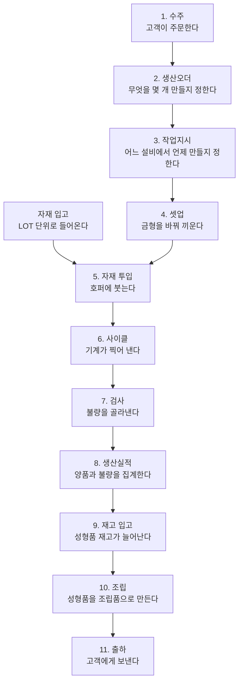

# 공장 흐름

ERD를 그리기 전에 "공장에서 실제로 무슨 일이 어떤 순서로 일어나는가"를 정리한 문서입니다. 주문 하나를 처음부터 끝까지 따라갑니다. 테이블과 컬럼 설계는 담지 않았습니다.

- 숫자는 설명을 위한 예시입니다.
- 이미 정한 결정(계획서의 "아키텍처 결정", "ERD 설계 결정")을 따랐습니다.
- 흐름을 따라가며 정한 규칙은 맨 아래 "흐름에서 정한 규칙"에 모았습니다.

## 한 장으로 보기



## 공장이 만드는 것

자동차 바깥쪽에 붙는 플라스틱 마감재입니다. 틈을 가려 보기 좋게 하고 빗물과 바람 소리를 막습니다. 차의 왼쪽(LH)과 오른쪽(RH)에 하나씩 붙어 좌우 한 쌍인 것이 많습니다.

| 제품 | 어디에 붙는가 | 생김새 |
| --- | --- | --- |
| 윈드실드 사이드 몰딩 | 앞유리의 왼쪽·오른쪽 가장자리. 유리와 차체 기둥 사이 | 길고 가느다란 검은 플라스틱 띠 |
| 루프랙 커버 | SUV 지붕 위 짐 싣는 레일의 끝이나 가운데 | 검은 플라스틱 덮개 |

제품 하나가 만들어지는 데 다섯 가지 물건이 나옵니다.

```
[사 오는 것]              [공장에서 만드는 것]           [파는 것]

수지 ─────┐
          ├─(사출)→ 성형품 ─┐
마스터배치 ─┘                ├─(조립)→ 완제품 → 고객사
                   클립 ────┘
```

| 물건 | 실제로 무엇인가 | 품목 종류 | 단위 | LOT 추적 |
| --- | --- | --- | --- | --- |
| 수지 | 쌀알만 한 플라스틱 알갱이. 25kg 포대로 들어온다. 녹여서 틀에 쏘는 주재료 | 원자재 | kg | 함 |
| 마스터배치 | 색을 내는 알갱이. 수지에 조금 섞으면 전체가 검은색이 된다 | 원자재 | kg | 함 |
| 성형품 | 수지를 금형에 쏴서 굳힌 플라스틱 몸통. 아직 차에 붙일 수 없다 | 반제품 | 개 | 안 함 |
| 클립 | 몸통을 차체에 고정하는 작은 부품. 몸통 뒷면에 끼운다 | 원자재 | 개 | 함 |
| 완제품 | 성형품에 클립을 끼운 것. 이 상태로 고객사에 간다 | 완제품 | 개 | 안 함 |

- 공장이 생산하는 것은 성형품(사출)과 완제품(조립) 둘입니다. 생산오더와 작업지시는 이 둘에만 생깁니다.
- 사 오는 것은 수지, 마스터배치, 클립 셋입니다.
- 고객이 주문하는 것은 완제품뿐입니다.
- 제품 하나에 품목이 두 줄 생깁니다: 성형품과 완제품.

## 등장하는 것들

흐름을 따라가기 전에, 미리 정해져 있어야 하는 것들입니다. 이것을 기준정보라고 부릅니다.

| 무엇 | 예 | 설명 |
| --- | --- | --- |
| 품목 | 사이드 몰딩 LH (완제품), 사이드 몰딩 LH 성형품 (반제품), PP 수지 (원자재) | 사고, 만들고, 파는 모든 물건 |
| BOM | 완제품 1개 = 성형품 1개 + 클립 2개 / 성형품 1개 = 수지 0.12kg + 마스터배치 0.002kg | 무엇을 만드는 데 무엇이 얼마나 드는지 |
| 라인 | 사출 1라인, 조립 1라인 | 설비의 묶음 |
| 설비 | 3호기 (650톤 사출성형기) | 기계 한 대 |
| 금형 | M-01 (사이드 몰딩 LH 성형품용, 2칸) | 품목의 형상을 만드는 틀. 한 번에 몇 개 나오는지가 정해져 있다 |
| 금형-설비 | M-01을 3호기에 올리면 한 사이클에 45초 | 어느 금형을 어느 설비에 올릴 수 있는지와 그때의 속도 |
| 교대와 달력 | 주간 06~14시, 오후 14~22시, 주 5일 | 공장이 언제 도는지 |

## 주문 하나를 따라가기

### 1. 수주: 고객이 주문한다

월요일 아침, 고객사가 "사이드 몰딩 LH 2,000개를 금요일까지" 납품하라고 지시합니다.

- 이 프로젝트에서는 수요 생성기가 매일 아침 수주를 만듭니다.
- 남는 것: 누가, 무엇을, 몇 개, 언제까지.

### 2. 생산오더: 무엇을 몇 개 만들지 정한다

수주는 "완제품 2,000개"만 말합니다. 공장은 이것을 BOM에 따라 아래로 펼칩니다. 이 일을 전개라고 합니다.

- 완제품(조립품) 2,000개를 만들려면 성형품 2,000개가 필요합니다.
- 창고에 쓸 수 있는 완제품 재고가 있으면 먼저 그것으로 채우고 모자란 만큼만 만듭니다. 이 예에서는 재고가 없다고 합시다.
- 성형품은 불량이 나므로 조금 더 만듭니다. 금형 M-01의 예상 수율이 98%라면 2,000 ÷ 0.98 = 약 2,040개입니다.
- 성형품 2,040개에는 수지 약 245kg(0.12kg × 2,040)이 필요합니다. 25kg 포대로 약 10포대입니다.

그래서 생산오더가 둘 생깁니다: "성형품 2,040개를 사출하라"와 "완제품 2,000개를 조립하라".

- 이 프로젝트에서는 계획 배치가 이 일을 합니다.
- 남는 것: 어느 수주 때문에, 무엇을, 몇 개, 언제까지 만들어야 하는지.

### 3. 작업지시: 어느 설비에서 언제 만들지 정한다

생산오더는 "무엇을 몇 개"까지만 정합니다. 작업지시는 그것을 현장의 말로 바꿉니다.

- 성형품 2,040개를 금형 M-01(2칸)로 찍으면 1,020사이클입니다.
- 3호기에서 사이클당 45초이므로 약 12시간 45분이 걸립니다.
- 그래서 "화요일 06시부터 3호기에서 금형 M-01로 성형품 2,040개"라는 작업지시가 나옵니다.
- 작업지시는 하루 단위입니다. 하루(06~22시, 16시간)에 다 못 만드는 분량이면 다음 날 작업지시가 따로 나옵니다.

core가 이 작업지시를 MQTT로 3호기에 내려보내고, 시뮬레이터의 3호기가 받습니다.

- 남는 것: 어느 생산오더를, 어느 설비에서, 어느 금형으로, 언제부터, 몇 개.

### 4. 셋업: 금형을 바꿔 끼운다

3호기에는 직전 작업의 금형이 올라가 있습니다. 작업자가 그것을 내리고 M-01을 올립니다. 온도를 맞추고 시험 사출을 합니다.

- 이 30분~1시간 동안 설비 상태는 "셋업"이고 제품은 나오지 않습니다.
- 조건이 안정되기 전에 나온 몇 개는 버립니다. 이것이 초기허용불량입니다.
- 남는 것: 설비가 언제부터 언제까지 어떤 상태였는지.

### 5. 자재 투입: 호퍼에 붓는다

자재는 그 전에 이미 창고에 들어와 있어야 합니다. 공급사에서 수지 40포대가 한꺼번에 들어오면 그것이 LOT 하나(LOT-A)입니다.

- 작업자가 창고에서 LOT-A 포대를 가져와 3호기의 호퍼에 붓습니다. "09:00, 3호기, LOT-A, 25kg".
- 통이 비어 가면 다음 포대를 붓습니다. 13:20에 부은 포대는 LOT-B였습니다.
- 부은 만큼 자재 재고가 줄어듭니다.
- 남는 것: 어느 설비에, 어느 LOT를, 언제, 얼마나 부었는지. 그리고 재고가 줄었다는 이동 기록.

### 6. 사이클: 기계가 찍어 낸다

3호기가 45초마다 한 번씩 금형을 닫고, 수지를 쏘고, 식히고, 열어서 꺼냅니다. 한 번에 성형품 2개가 나옵니다.

- 사이클마다 3호기가 메시지 하나를 보냅니다: 몇 번째 사이클인지, 사이클 타임, 온도, 압력.
- 기계는 방금 나온 것이 양품인지 불량인지 모릅니다.
- 중간에 멈추기도 합니다. 짧게(1~5분) 자주 멈추고, 가끔 길게(30분 이상) 멈춥니다.
- 남는 것: 사이클 로그 한 줄. 하루에 설비 한 대가 약 1,000줄을 만듭니다.

### 7. 검사: 불량을 골라낸다

나온 성형품을 사람이나 검사 장비가 봅니다. 불량을 발견하면 따로 기록합니다.

- "14:32, 3호기의 작업지시에서, 은줄 3개".
- 찍힌 시각보다 조금 늦게 기록됩니다.
- 이 프로젝트에서는 시뮬레이터가 검사 결과 메시지를 따로 보냅니다.
- 남는 것: 언제, 어느 작업지시에서, 어떤 유형이, 몇 개.

### 8. 생산실적: 양품과 불량을 집계한다

core가 1분마다 진행 중인 작업지시의 실적을 다시 계산합니다.

- 만든 수량 = 사이클 수 × 금형의 칸 수. 600사이클이면 1,200개입니다.
- 불량 수량 = 그 작업지시에 붙은 불량 기록의 합. 예를 들어 18개.
- 양품 수량 = 1,200 − 18 = 1,182개.

화면의 현황판은 이 숫자를 봅니다. "3호기: 계획 2,040, 양품 1,182, 진척 58%".

- 남는 것: 작업지시별(그리고 교대별) 양품 수량과 불량 수량.

### 9. 재고 입고: 성형품 재고가 늘어난다

교대가 끝나거나 작업지시가 끝나면 실적을 확정합니다. 이것을 마감이라고 합니다.

- 마감된 양품 수량만큼 성형품 재고가 늘어납니다.
- 사이클을 받을 때마다 재고를 늘리지 않는 이유는, 늦게 온 메시지나 불량 기록 때문에 숫자가 바뀔 수 있어서입니다.
- 완제품이 들어올 때는 그 주문 몫으로 바로 예약을 잡습니다. 그래야 다른 주문이 가져가지 않습니다.
- 남는 것: "성형품 +1,182, 이유는 이 작업지시의 생산"이라는 이동 기록, 그리고 바뀐 현재고.

### 10. 조립: 성형품을 조립품으로 만든다

조립 라인이 성형품에 클립을 끼워 완제품을 만듭니다. 성형품이 창고에 들어와 있어야 하므로 사출 다음 근무일 이후에 합니다. 흐름은 사출과 같습니다.

- 조립 작업지시가 있고, 조립 설비가 하나 끼울 때마다 사이클 메시지를 보내고, 실적이 집계됩니다. 온도나 압력 같은 공정값은 없습니다.
- 다른 점은 투입하는 자재가 수지가 아니라 성형품이라는 것입니다. 성형품 재고가 줄고 완제품 재고가 늘어납니다.

### 11. 출하: 고객에게 보낸다

금요일, 출하 배치가 완제품 2,000개를 고객사로 보냅니다.

- 완제품 재고가 2,000개 줄어듭니다.
- 수주가 "납품 완료"가 됩니다.
- 재고가 모자라면 납기를 못 맞춘 것입니다. 에이전트의 납기 위험 점검이 이것을 미리 찾습니다.
- 남는 것: 어느 수주에 대해, 무엇을, 몇 개, 언제 보냈는지. 그리고 재고 이동 기록.

## 흐름마다 다른 시간의 단위

같은 공장의 일이지만 일어나는 빈도가 크게 다릅니다. 장부마다 줄 수가 다른 이유입니다.

| 일 | 얼마나 자주 | 180일이면 대략 |
| --- | --- | --- |
| 수주 | 하루에 수십 건 | 수천 줄 |
| 작업지시 | 설비당 하루 2건 안팎 | 수천 줄 |
| 자재 투입 | 설비당 하루 몇 번 | 수만 줄 |
| 불량 기록 | 설비당 하루 수십 번 | 수십만 줄 |
| 사이클 | 설비당 45초마다 | 수백만 줄 |

## 옆에서 같이 도는 흐름

주문을 따라가는 흐름 말고도 계속 일어나는 일이 있습니다.

- **자재 입고**: 자재 재고가 기준선(재주문점) 아래로 내려가면 주문하고, 며칠 뒤(리드타임) LOT 단위로 들어옵니다. 자재 재고가 늘어납니다.
- **설비 상태 변화**: 설비는 가동, 대기, 셋업, 고장, 비가동 중 하나의 상태에 있고 상태가 바뀔 때마다 메시지로 알립니다. 시간가동률은 여기서 나옵니다. 설비는 이런 사건 외에 2초마다 지금의 온도와 압력(계측값)도 보냅니다. 메시지의 전체 목록은 `ontology/contracts.md`에 있습니다.
- **사건 주입**: 시뮬레이터가 매일 한두 건의 문제(설비 고장, 건조 불량 LOT)를 일부러 일으키고 정답지에 적어 둡니다.
- **일마감**: 밤에 그날의 숫자를 일자별로 모아 둡니다.

## 누가 무엇을 하는가

실제 공장에서 사람과 기계가 하는 일을, 이 프로젝트에서는 프로그램이 나눠 맡습니다.

| 실제 공장 | 이 프로젝트 |
| --- | --- |
| 고객사의 주문 | core의 수요 생성 배치 |
| 생산관리 담당자의 계획 | core의 계획 배치 |
| 사출성형기 | simulator (사이클 메시지) |
| 검사원 | simulator (검사 결과 메시지) |
| 자재를 붓는 작업자 | simulator (자재 투입 메시지) |
| 자재 구매와 입고 | core의 입고 배치 |
| 출하 담당자 | core의 출하 배치 |
| 실적 집계 | core의 1분 재집계 |
| 현황을 묻는 관리자 | 화면과 에이전트 |

## 흐름에서 정한 규칙

흐름을 따라가며 나온 일곱 가지를 정했고, ERD를 계획과 대조하면서 네 가지를 더했습니다(2026-11-23).

| 무엇 | 결정 | 이유 | 치르는 것 |
| --- | --- | --- | --- |
| 수주의 모양 | 수주 하나에 품목 여럿. 주문서를 머리와 줄로 나눔 | 좌우 한 쌍처럼 여러 품목을 한 번에 주문하는 모습을 담음 | 장부가 하나 늘고, 생산오더와 출하가 줄을 가리켜야 함 |
| 재고가 이미 있을 때 | 수주 줄마다 "재고에서 채울 수량"과 "새로 만들 수량"을 나눔. 채우기로 한 재고는 예약으로 잡아 둠. 생산오더는 수주 줄 하나만 가리킴 | 수주에서 생산까지 한 줄로 따라갈 수 있고, 여유분 재고가 다음 주문에 쓰여 쌓이지 않음 | 예약을 잡고 푸는 경로가 생김. 실제 MRP와 달리 여러 주문을 묶어 만들지 않고 생산 중인 수량도 계산에 넣지 않음 |
| 불량 여유분 | 금형마다 예상 수율을 두고 "필요 수량 ÷ 수율"만큼 지시 | 납기 지연을 가장 큰 위험으로 봄. 금형마다 불량률이 다르므로 일괄 비율은 모자람. 같은 숫자가 에이전트의 "평소 대비" 기준이 됨 | 기준정보에 값이 하나 늘어남. 사건이 난 날은 그래도 모자라므로 부족분을 추가로 만드는 경로가 필요함 |
| 작업지시의 단위 | 하루마다 끊음. 밤을 넘기는 작업지시는 없음 | 야간 비가동을 걸치는 멈춤과 재개를 다루지 않아도 됨. 참고 데이터의 구조와 같음. "내일로 미뤄줘"가 하루치를 옮기는 뜻이 됨 | 며칠 걸리는 생산은 작업지시가 나뉘므로, 같은 금형으로 이어지는 작업은 셋업이 없다는 것을 알아야 함 |
| 조립 | 사출과 같은 방식. 조립 설비도 사이클마다 메시지를 보내되 공정값은 없음 | 설비 20대가 수집·집계·화면에서 같은 길을 탐. 성형품이 조립의 재료가 되는 흐름은 유지됨 | 조립에는 금형이 없고 공정값 칸이 비어 있음. ERD에서 풀어야 함 |
| 자재 입고 | 재주문점 방식. 재고가 기준선 아래로 내려가면 주문하고 리드타임 뒤에 LOT로 도착 | 아무도 손대지 않아도 재고가 균형을 잡음. 자재가 늦게 오는 납기 위험 장면이 생김 | 자재마다 기준선과 주문량을 정해야 하고 "오는 중" 상태를 다뤄야 함 |
| 생산한 완제품의 몫 | 완제품이 재고에 들어올 때 그 수주 줄 몫으로 예약을 함께 잡음 | 잡지 않으면 다음 주문의 계획이 그 재고를 "쓸 수 있는 재고"로 보고 가져감 | 예약에 출처(재고에서 잡은 것, 생산해서 잡은 것)를 구분해야 함 |
| 금형 고르기 | 계획 배치가 금형을 먼저 고르고 그 금형의 수율로 지시 수량을 계산 | 품목 하나에 금형이 여러 벌이면 수율이 다름 | 금형이 정비 중이면 다른 금형을 골라야 함 |
| 양품이 모자랄 때 | 같은 생산오더에 작업지시를 더 붙임. 생산오더는 필요 수량을 채울 때까지 열려 있음 | 생산오더는 "얼마를 채워야 하나", 작업지시는 "오늘 할 일감"이라는 구분이 분명해짐 | 추가 작업지시도 셋업이 필요하고 납기를 넘길 수 있음. 에이전트의 납기 위험 점검이 찾아야 하는 장면 |
| 사출과 조립의 순서 | 조립 작업지시는 사출 작업지시의 다음 근무일 이후로 잡음 | 조립은 성형품이 창고에 들어온 뒤에야 할 수 있음 | 납기에서 거꾸로 계산하면 사출은 납기 이틀 전까지 끝나야 함 |
| 호퍼에 남은 자재 | 추적하지 않음. 다음 작업지시가 이어서 씀 | 투입 기록이 설비에 붙어 있어 작업지시가 바뀌어도 "지금 쓰는 LOT"가 이어짐. 원가 계산은 범위 밖 | 통에 남은 양과 자재를 바꿀 때 버린 양은 장부에 없음. 한계로 밝힘 |

재고 예약의 예입니다. 창고에 완제품이 500개 있을 때 주문이 차례로 들어오면 이렇게 됩니다.

| 주문 | 수량 | 재고에서 채움 | 새로 만듦 | 쓸 수 있는 재고 |
| --- | --- | --- | --- | --- |
| #101 | 2,000 | 500 | 1,500 | 0 |
| #102 | 800 | 0 | 800 | 0 |
| (#101 생산 후 여유분 30개가 남음) | | | | 30 |
| #103 | 1,000 | 30 | 970 | 0 |

재고에는 숫자가 둘 있습니다: 창고에 있는 수(현재고)와 쓸 수 있는 수(현재고 − 예약).

## ERD를 그리면서 답할 질문

- 수주: 납기일은 머리에 적는가 줄에 적는가. 줄 하나를 두 번에 나눠 출하할 수 있는가.
- 예약: 잡아 둔 재고는 언제 풀리는가. 주문이 취소되면 어떻게 되는가. 주문을 어떤 순서로 처리해 재고를 나눠 주는가.
- 수율: 예상 수율은 금형에 두는가, 금형-설비 관계에 두는가.
- 작업지시: 같은 생산오더의 어제 작업지시와 오늘 작업지시가 이어진다는 것을 어떻게 아는가. 하루 분량을 다 못 채운 부족분은 어디로 가는가.
- 조립: 금형이 없는 조립의 작업지시는 금형 칸을 어떻게 하는가. 사이클 로그의 공정값 칸이 빈 줄을 한 장부에 둘 것인가.
- 자재 입고: "주문했고 오는 중"을 어디에 적는가. 같은 자재를 이미 주문했는데 또 주문하는 것을 무엇이 막는가.
