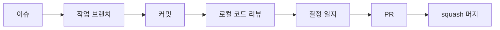

# 개발 방식

이 프로젝트는 Claude Code와 함께 만듭니다. 무엇을 사람이 하고 무엇을 맡기는지, 틀리지 않게 하려고 어떤 장치를 뒀는지를 적습니다.

## 누가 무엇을 하는가

| 분담 | 대상 |
| --- | --- |
| 사람이 직접 | ERD와 온톨로지, 집계 쿼리와 튜닝, 수집기의 멱등성 설계, 도구의 권한과 승인 설계, 평가셋과 지표 |
| 함께 | 첫 번째 수직 흐름, 에이전트의 그래프, 시뮬레이터의 상태 머신, 공장 화면. 계획을 먼저 보고 승인한 뒤 구현 |
| 맡김 | 두 번째 이후의 CRUD, 테스트 뼈대, 타입 생성, 인프라 코드, CI, 문서 동기화 |

## 규칙이 두 층입니다

- **저장소 전체의 규칙**: 설계 규칙, 계층 사이의 계약, 작업 절차. 어느 한 파트의 것이 아닙니다.
- **파트별 규칙**: 그 파트의 언어와 도구에 맞춘 코드 규칙, 테스트 규칙, 절차. 그 폴더의 파일을 다룰 때만 읽힙니다.

## 작업 하나의 흐름

- **모든 작업은 이슈에서 시작합니다.** `main`에 직접 커밋하지 않습니다.
- **PR 전에 리뷰를 돌립니다.** 코드를 쓴 세션이 아닌 새 세션이 읽습니다. 지적은 코드와 대조해 맞는 것만 고치고, 결과를 PR에 남깁니다.
- **결정마다 기록을 남깁니다.** 무엇을 고르고 무엇을 버렸는지, AI의 제안을 어디서 바꿨는지, AI가 무엇을 틀렸는지를 적습니다.

## 어긋남을 막는 장치

| 장치 | 막는 것 |
| --- | --- |
| 온톨로지 정합성 검사 | ERD, 온톨로지, 계약 문서가 서로 다른 말을 하는 것 |
| 구현 상태의 자동 생성 | 문서가 코드보다 앞서 나가는 것. 온톨로지에 적힌 테이블이 스키마에 실제로 있는지 대조합니다 |
| PR 전의 문서 영향 확인 | 코드나 규칙을 바꾸고 손으로 쓴 문서를 그대로 두는 것 |
| 실제 Oracle에서 도는 테스트 | 다른 DB에서는 통과하고 Oracle에서는 깨지는 SQL |
| 스키마 테스트 | 이름 없는 제약, 인덱스 없는 외래 키 |
| 층마다 테스트가 있는지 보는 검사 | Controller, Facade, Service, Mapper의 클래스를 만들고 테스트를 빠뜨리는 것. 테스트가 경우를 모두 다루는지는 보지 못합니다 |
| 테스트를 먼저 쓰게 하는 훅 | 테스트 없이 구현부터 쓰는 것. 에이전트가 네 층의 파일을 쓰려는 순간에 테스트 파일이 없으면 쓰기를 막습니다. 사람이 편집기로 쓰는 파일은 위의 검사가 봅니다 |
| 속성 기반 테스트 (예정) | 승인 없는 변경의 실행, 중복과 순서에 따라 달라지는 집계 |

같은 실수를 두 번 하면 규칙, 검사, 훅 중 하나를 더하고 [진행 상황](#/progress)의 "하네스 변경 기록"에 적습니다.
